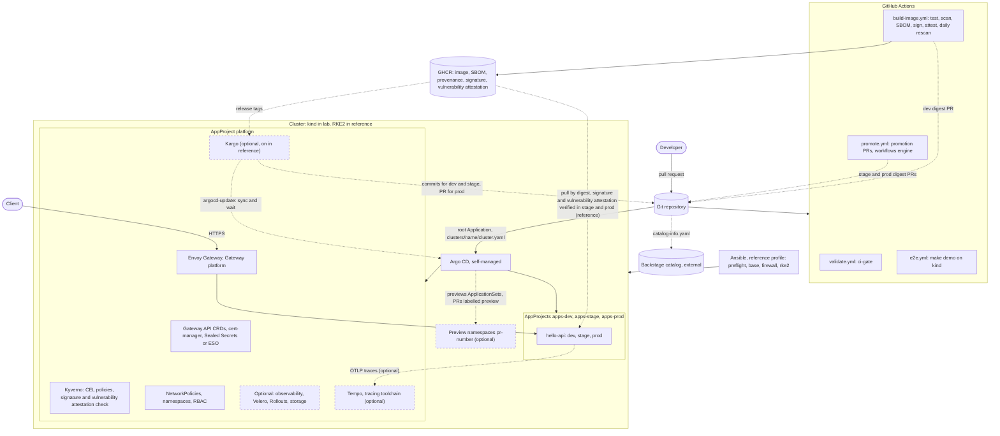

# sk-k8s-devops-bootstrap

A GitOps reference platform for Kubernetes: Ansible provisions RKE2, Argo CD reconciles the platform and the workloads from this repository, and GitHub Actions validates, signs and promotes every change.

[](https://github.com/SritharanK/sk-k8s-devops-bootstrap/actions/workflows/validate.yml)
[](https://github.com/SritharanK/sk-k8s-devops-bootstrap/actions/workflows/e2e.yml)
[](https://scorecard.dev/viewer/?uri=github.com/SritharanK/sk-k8s-devops-bootstrap)
[](LICENSE)

**Status.** Reference implementation. The `lab` profile is deployed on kind and tested end to end in CI on every pull request. The `reference` profile (RKE2 HA) is implemented and exercised by local harnesses in `tests/integration/` (three-node kind, Dex for SSO, an RKE2 VM); it is not run on real HA infrastructure in CI. Items that are not implemented yet are listed as planned in [Status and roadmap](#status-and-roadmap).

## What this is

- A small, opinionated platform for one Kubernetes cluster with `dev`, `stage` and `prod` namespaces, delivered entirely through Git.
- A worked example of the decisions behind such a platform: distribution, GitOps structure, ingress, policy, secrets, supply chain and promotion. Each decision is recorded as an ADR in [docs/adr](docs/adr/README.md).
- Something you can run on a laptop in about ten minutes (`make demo`) and read in an afternoon.

## What this is not

- Not a managed service or a product installer. You operate the cluster, the identity provider and the registry.
- Not a multi-cluster fleet manager. Both profiles run one cluster. A two-cluster topology (nonprod and prod behind one hub Argo CD) is implemented in the bootstrap chart as hub mode, but not tested in CI.
- Not a substitute for your own security review. Known gaps are listed in [known limitations](docs/security/known-limitations.md).

## Architecture



Components with a dashed border are optional and off by default. Kargo, `monitoring`, `argo-rollouts` and Longhorn are the exceptions: the `reference` profile turns them on, Longhorn as its default StorageClass and the other three so that Kargo verifies every promotion. A cluster file that enables Kargo makes it the only writer of the environment files: `build-image.yml` and `promote.yml` then stand back unless the repository variable `PROMOTION_ENGINE` is `workflows`.

How it fits together:

- One file per cluster, `clusters/<name>/cluster.yaml`, describes the cluster. Ansible reads it to install RKE2, and the root Argo CD Application passes it to the `argocd-bootstrap` chart as values. See [configuration](docs/reference/configuration.md).
- `argocd-bootstrap` renders one Argo CD Application per platform component (a toolchain) and one per app and environment. Toolchains sync in waves under the `platform` AppProject. Apps run under `apps-<env>` projects that cannot create cluster-scoped objects. See [GitOps structure](docs/architecture/gitops.md).
- Platform components are thin wrapper charts over pinned upstream charts. Workloads use the `helm-common` library chart, which renders the workload contract the policies enforce. See [helm-common values](docs/reference/helm-common-values.md).
- Images are built, scanned, signed and attested in GitHub Actions, deployed by digest once the first build has run, and promoted from `dev` to `stage` to `prod`. Without Kargo, `build-image.yml` and `promote.yml` open a pull request per step. With the optional `kargo` toolchain (on in the `reference` profile), Kargo commits `image.tag` and `image.digest` for `dev` and `stage`, opens a pull request for `prod`, and verifies each stage with the `success-rate` analysis of the `argo-rollouts` and `monitoring` toolchains (both on in `reference`). One engine writes at a time: the repository variable `PROMOTION_ENGINE` (`workflows` or `kargo`) decides, and when it is unset, a cluster file that enables Kargo selects Kargo. Argo CD applies every change in both paths. See [CI/CD](docs/architecture/ci-cd.md), [promotion](docs/operations/promotion.md) and [ADR 0012](docs/adr/0012-kargo-promotion.md).
- Optional, off by default: pull request preview environments, where a pull request labelled `preview` gets a namespace `pr-<number>` from an ApplicationSet with the GitHub pull request generator ([preview environments](docs/how-to/preview-environments.md)), and distributed tracing, where apps built on helm-common send OpenTelemetry traces over OTLP to Tempo, and Grafana links logs to traces and back; the link from metric exemplars works once Prometheus runs with exemplar storage, which the monitoring chart does not set yet ([tracing](docs/how-to/tracing.md)).
- `catalog-info.yaml` describes the platform, `hello-api`, its API and the charts as Backstage catalog entities, with this documentation as TechDocs. `make lint-catalog` validates it.

## Profiles

| | `lab` | `reference` |
| --- | --- | --- |
| Purpose | Evaluation, development, CI end-to-end test | A single production-shaped cluster |
| Cluster | kind (1 control plane, 2 workers) or one node | RKE2 HA: 3 servers behind a registration address, agents |
| Provisioning | `make demo` | Ansible: `make preflight CLUSTER=reference`, `make bootstrap-k8s CLUSTER=reference` |
| Domain and TLS | `*.localtest.me`, CA-backed self-signed issuer | Your domain; Let's Encrypt per host (HTTP-01) or wildcard (DNS-01) |
| Secrets | Sealed Secrets, sealed offline | External Secrets Operator with OpenBao |
| Argo CD access | Initial admin secret | OIDC SSO, local admin disabled |
| Image signature and vulnerability attestation verification | Off (the demo loads a locally built image) | Enforced in `stage` and `prod` |
| Promotion engine | `build-image.yml` and `promote.yml` pull requests | Kargo, each promotion verified with `success-rate` (`argo-rollouts` and `monitoring` on). The engine is per repository: a cluster file that enables Kargo selects it unless `PROMOTION_ENGINE=workflows` |
| Tested | Every pull request and nightly | Local harnesses in `tests/integration`; real infrastructure by hand |

Both profiles use the same chart set; toolchain switches differ per profile, and the charts differ only in `values-<profile>.yaml` files and the cluster file. The reasoning is in [ADR 0005](docs/adr/0005-lab-and-reference-profiles.md).

## Quick start (lab)

Requirements: Docker with about 8 GB of memory, `make`, and the tools pinned in `mise.toml` (or open the repository in the devcontainer). Details in [prerequisites](docs/getting-started/prerequisites.md).

```bash
git clone https://github.com/SritharanK/sk-k8s-devops-bootstrap.git
cd sk-k8s-devops-bootstrap
mise install               # or use the devcontainer
make demo                  # kind cluster, Argo CD, platform, hello-api
SKIP_UP=1 KEEP=1 make e2e  # the same assertions CI runs, against the running demo
make demo-down             # remove the cluster
```

Without `SKIP_UP=1`, `make e2e` brings the demo up itself; without `KEEP=1`, it deletes the cluster at the end.

`make demo` prints the Argo CD URL (`https://argocd.localtest.me`) and the app URL (`https://hello-api.dev.localtest.me`). The full walkthrough, including a policy denial you can trigger yourself, is in the [quick start](docs/getting-started/quick-start.md).

## Production path (reference profile on RKE2)

```bash
make validate-config STRICT=1 CLUSTER=reference  # schema, consistency, no placeholders left
make preflight CLUSTER=reference                 # inventory, OS, swap, kernel modules, placeholders
make bootstrap-k8s CLUSTER=reference             # RKE2 servers one at a time, then agents
make bootstrap-gitops CLUSTER=reference          # Argo CD, AppProjects and the root Application
```

The inventory, the Ansible vault, the secrets backend, DNS and a load balancer address for the Gateway come first. Follow [production setup](docs/getting-started/production-setup.md) step by step.

## Supply chain and policy

- Build: on `main`, `build-image.yml` runs tests, builds with BuildKit SBOM and maximum provenance, pushes to GHCR, then scans the pushed digest with Trivy (fixable CRITICAL and HIGH fail the job). Only an image that passes the scan is signed with cosign keyless through GitHub OIDC, gets a cosign vulnerability attestation with the Trivy report and GitHub artifact attestations, gets the release tag from `sample-services/<app>/VERSION` (an existing tag is never moved), and, with the workflows engine, reaches the dev bump pull request. A failing image stays in GHCR unsigned. A daily rescan attests every digest pinned in `envs/` again. On pull requests the image is built and scanned locally, never pushed. The output is a digest.
- Deploy by digest: environment values in `envs/<env>/<app>/values.yaml` hold `image.tag` and `image.digest`. In a fresh fork `image.digest` is empty in every environment and the image is pulled by tag; with the workflows engine the first `build-image.yml` run on `main` opens the pull request that sets the dev digest, and `promote.yml` carries it to `stage` and `prod`; with Kargo, the `dev` Stage writes it. `hack/promotion-engine.sh` decides which engine writes: Kargo whenever a cluster file enables it, as the shipped `reference` file does, unless the repository variable `PROMOTION_ENGINE` is `workflows`. Promotion copies the digest that runs in the previous environment; when `ARGOCD_SERVER` and the source environment's token are configured, `promote.yml` first checks that it is Synced and Healthy, otherwise the reviewer checks it. Nothing merges automatically. With Kargo, a stage accepts only a release verified in the stage before it, and `prod` still changes through a reviewed pull request; one engine writes the environment files at a time.
- Admission: Kyverno CEL policies enforce the workload contract (non-root, no privilege escalation, all capabilities dropped, seccomp `RuntimeDefault`, read-only root filesystem, requests and limits, probes, no `latest`, registry allowlist): Audit in `dev`, Enforce in `stage` and `prod`. In the `reference` profile an `ImageValidatingPolicy` admits images in `stage` and `prod` only when they are signed by this repository's build workflow on `main` and carry a vulnerability attestation from the same identity that is younger than `maxScanAge` (168h) and lists no CRITICAL finding. Pod Security Admission `restricted` applies to all app namespaces.
- Network: Default-deny ingress and egress in app namespaces, with explicit allow rules per app and baseline policies for platform namespaces.

Details: [security controls](docs/security/controls.md), [supply chain](docs/security/supply-chain.md), [threat model](docs/security/threat-model.md).

## What is tested

Every pull request runs `validate.yml`; the single required check is `ci-gate`, which fails if any job fails. No job is advisory.

| Area | Check | Job |
| --- | --- | --- |
| Workflows | actionlint, zizmor | `workflow-lint` |
| Secrets | gitleaks on the tree, full history weekly; no committed `kind: Secret` with data outside Helm templates and `*.example.yaml` files | `secrets` |
| Commits | Conventional Commits subjects | `commit-lint` |
| YAML, Markdown, links | yamllint, markdownlint, lychee | `yaml-lint`, `docs` |
| Shell | shellcheck, shfmt, self-tests of the shell library and of the promotion engine selection | `shell-lint` |
| Cluster files | JSON Schema, placeholder check | `config` |
| Ansible | ansible-lint (production profile), syntax check, Molecule | `ansible` |
| OpenTofu | `tofu fmt -check`, `tofu validate`, `tofu test` with a mocked provider | `opentofu` |
| Helm | dependency build, `lint --strict` per profile, helm-unittest of helm-common and of the argocd-bootstrap templates (Kargo pipelines, monitoring, previews, image signing) | `helm` |
| Argo CD bootstrap | every Application and chart rendered per profile in both modes, kubeconform at 1.36 and 1.35 with the CRD schemas, AppProject permission check | `argocd-bootstrap` |
| Policies | `kyverno test` fixtures, `kyverno apply` against rendered apps | `policy-test` |
| Vulnerability attestation gate | `kyverno test` against images signed and attested with an ephemeral key in a throwaway local registry | `policy-test-attestations` |
| Backstage catalog | Entity validation of `catalog-info.yaml` | `catalog-lint` |
| Containers | hadolint, container smoke test | `dockerfile-lint` |
| Rendered manifests | Trivy misconfiguration scan | `trivy-config` |
| Jenkins adapter | declarative linter | `jenkins-lint` |
| End to end | `make demo` on kind; all Applications Synced and Healthy, `hello-api` through the Gateway, privileged, root and `latest` pods denied, cross-namespace traffic blocked, values commit rolls out | `e2e-kind` (nightly also in `e2e.yml`) |

## Status and roadmap

| Capability | Status |
| --- | --- |
| Lab profile on kind, `make demo` | Tested in CI (`e2e-kind`) |
| Argo CD app of apps, AppProjects, sync waves, self-managed Argo CD | Tested in CI |
| Gateway API with Envoy Gateway, TLS from cert-manager | Tested in CI |
| Kyverno CEL policies, Pod Security Admission, PolicyExceptions | Tested in CI (`policy-test`, `e2e-kind`) |
| Default-deny NetworkPolicies | Tested in CI (`e2e-kind`) |
| `helm-common` library chart and `hello-api` | Tested in CI (`helm`, `dockerfile-lint`, `e2e-kind`) |
| Image build, scan, SBOM, provenance, keyless signing | Runs in CI on `main` (`build-image.yml`) |
| Promotion by pull request and digest | Implemented (`promote.yml`) |
| Ansible: preflight, base, firewall, RKE2 | Lint and Molecule in CI; RKE2 install on a local VM (`tests/integration/rke2`) |
| Reference profile: RKE2 HA, ESO with OpenBao, SSO | Implemented; local harnesses (`tests/integration/reference`, `tests/integration/sso`), not in CI |
| Image signature verification at admission | Implemented, `reference` profile only |
| Backup and restore (etcd snapshots, Velero), restore drill | Implemented, optional |
| Observability profile, SLOs, Argo Rollouts canary | Implemented, optional |
| RKE2 upgrades with system-upgrade-controller | Implemented, optional |
| Jenkins on-premises adapter | Implemented, optional |
| Two-cluster topology through a hub Argo CD (hub mode) | Implemented in the bootstrap chart, not tested in CI |
| Distributed tracing: OpenTelemetry in `hello-api` and `helm-common`, Tempo | Implemented, optional; unit tests in CI, end to end with `make integration-tracing` on kind |
| Pull request preview environments | Implemented, optional (`toolchains.previews.enabled`); render tests in CI (`helm`) |
| Documentation site (MkDocs, GitHub Pages) | Implemented; strict build in CI (`docs.yml`) |
| `helm-common` BackendTrafficPolicy and KEDA options | Implemented, optional; unit tests in CI (`helm`) |
| OpenTofu for one reference target (Hetzner Cloud, `infra/hetzner`) | Implemented; validated and tested offline in CI (`opentofu`), never applied in CI |
| Tenant onboarding from `tenants/<name>.yaml` (ApplicationSet, off by default) | Implemented, optional; tenant files schema-checked in CI (`config`) |
| Promotion orchestration with Kargo (optional; on in the shipped `reference` cluster file, which makes Kargo the promotion engine of the repository unless `PROMOTION_ENGINE` is `workflows`) | Implemented; render and unit tests in CI (`helm`, `argocd-bootstrap`), end to end on kind with `tests/integration/kargo` |
| Vulnerability attestation (Trivy, cosign) required at admission in `stage` and `prod` | Implemented, `reference` profile only; attestation tests in CI (`policy-test-attestations`) |
| Backstage catalog descriptors (`catalog-info.yaml`) | Implemented; validated in CI (`catalog-lint`) |
| `make new-app` | Planned |

Changes per release are in the [changelog](CHANGELOG.md). Component versions and their end-of-life dates are generated into the [support matrix](docs/reference/support-matrix.md) with `make support-matrix`.

## Repository layout

| Path | Contents |
| --- | --- |
| `clusters/` | One `cluster.yaml` per cluster (`lab`, `reference`) and `schema.json` |
| `infra/` | Optional OpenTofu example that creates the reference topology and its inventory |
| `ansible/` | Roles and playbooks for preflight, OS baseline, firewall and RKE2; inventories per profile |
| `bootstrap/` | Bootstrap chart: the root Application per cluster, hub mode, repository Secret template |
| `argocd-bootstrap/` | App of apps chart: toolchain and app Applications, AppProjects |
| `helmcharts/system-charts/` | Wrapper charts for platform components |
| `helmcharts/helm-common/` | Library chart for workloads, with unit tests |
| `helmcharts/app-charts/` | Thin app charts |
| `envs/` | Per-environment app values: digest and deltas |
| `tenants/` | Tenant definitions, their schema and the tenant chart |
| `sample-services/` | Owned sample service `hello-api` (Go) |
| `hack/` | Scripts behind the Make targets: render, validation, demo, e2e, DR drill |
| `scripts/` | Shared shell library and its self-test, operator helper scripts |
| `kind/` | kind cluster definition and pinned node images for the lab profile |
| `tests/` | Chainsaw end-to-end suite (`tests/e2e`), local integration harnesses (`tests/integration`) and the promotion engine fixtures (`tests/promotion-engine`) |
| `ci/jenkins/` | Optional Jenkins adapter: pipelines, job DSL, agent pod templates, linter config |
| `.github/workflows/` | Validation, build, promotion, e2e, documentation site, Scorecard, dependency review |
| `catalog-info.yaml` | Backstage catalog descriptors: system, `hello-api` and its API, `helm-common`, the charts |
| `docs/` | Documentation, see below |

## Documentation

Start at [docs/README.md](docs/README.md) for a reading order per audience.

- Getting started: [prerequisites](docs/getting-started/prerequisites.md), [quick start](docs/getting-started/quick-start.md), [production setup](docs/getting-started/production-setup.md)
- Architecture: [overview](docs/architecture/overview.md), [GitOps](docs/architecture/gitops.md), [CI/CD](docs/architecture/ci-cd.md), [decision records](docs/adr/README.md)
- Reference: [configuration](docs/reference/configuration.md), [helm-common values](docs/reference/helm-common-values.md), [Make targets](docs/reference/make-targets.md), [support matrix](docs/reference/support-matrix.md)
- Security: [controls](docs/security/controls.md), [threat model](docs/security/threat-model.md), [secrets](docs/security/secrets-handling.md), [supply chain](docs/security/supply-chain.md), [known limitations](docs/security/known-limitations.md), [Argo CD SSO](docs/security/argocd-sso.md)
- How-to: [tracing](docs/how-to/tracing.md), [traffic and scaling](docs/how-to/traffic-and-scaling.md), [preview environments](docs/how-to/preview-environments.md), [promote with Kargo](docs/how-to/promote-with-kargo.md), [documentation site](docs/how-to/documentation-site.md)
- Operations: [backup and restore](docs/operations/backup-and-restore.md), [Argo CD upgrade](docs/operations/upgrade-argocd.md), [RKE2 upgrade](docs/operations/upgrade-rke2.md), [secret rotation](docs/operations/secret-rotation.md), [adding an app](docs/operations/add-an-app.md), [promotion](docs/operations/promotion.md), [troubleshooting](docs/operations/troubleshooting.md), [observability contract](docs/operations/observability-contract.md)

## Contributing and security

Development setup, Make targets and commit conventions are in [CONTRIBUTING.md](CONTRIBUTING.md). Report vulnerabilities privately as described in [SECURITY.md](SECURITY.md), not in public issues.

## License

MIT, see [LICENSE](LICENSE). Third-party components keep their upstream licences; they are listed in [THIRD_PARTY_NOTICES.md](THIRD_PARTY_NOTICES.md).

## Author

Sritharan K ([github.com/SritharanK](https://github.com/SritharanK)).
