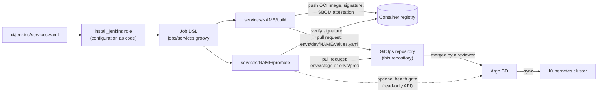

# Jenkins CI adapter

An optional, on-premises CI for this repository. GitHub Actions is the reference CI; use this adapter when builds must run on your own infrastructure. It follows the same contract as the reference CI: images are tagged, scanned, signed and pushed, and environments change only through pull requests that set `.image.tag` and `.image.digest` in `envs/<env>/<service>/values.yaml`. Argo CD deploys what is merged. Jenkins never deploys.

The controller is installed by the Ansible role `ansible/roles/install_jenkins` (`make install-jenkins`). This directory holds everything else.

| Path | Content |
|---|---|
| `services.yaml` | Services built and promoted by Jenkins, the environment order, the values file and Argo CD application name patterns. |
| `jobs/services.groovy` | Job DSL that turns `services.yaml` into jobs. Applied by configuration as code when the role runs. |
| `pipelines/build.Jenkinsfile` | Build job: test, build, scan, push, sign, open the dev change. |
| `pipelines/promote.Jenkinsfile` | Promote job: copy a verified digest to the next environment through a pull request. |
| `pod-templates/build.yaml`, `pod-templates/promote.yaml` | Agent pods of the two jobs. |
| `kubernetes/` | Agent namespace: Pod Security labels, service accounts, RBAC, quota, limit range, network policy. |
| `lint/`, `scripts/` | Inputs of `hack/jenkins-lint.sh` and the plugin resolver. |

## How the pieces fit



1. `services.yaml` lists the services. The role passes it to the Job DSL script through configuration as code, which creates the folder `services/<name>` with the jobs `build` and `promote` for every entry. No seed job runs repository Groovy at build time.
2. Both jobs are Pipeline jobs from SCM: they load their Jenkinsfile from `main` of the repository, run in the Groovy sandbox, and start a Kubernetes pod from the matching pod template.
3. The pipelines read `services.yaml` again from the commit they run, find their service from the job name (`services/<name>/<job>`) and validate every field before use.
4. The build job pushes a signed image and opens a pull request for the first environment. The promote job opens pull requests for the following environments. Reviewers merge; Argo CD syncs.

## Build flow

Job `services/<name>/build`. Triggered by SCM polling on `main`, restricted to `<path>/` of the service and `ci/jenkins/`. No parameters, no concurrent builds.

| Stage | Container | What happens |
|---|---|---|
| Resolve | jnlp | Checks out the commit. Parses the job name, which must be exactly `services/<name>/build`. Reads `services.yaml` and validates the entry (name, path under `sample-services/` without `..`, dockerfile, image, testTarget, platform), the values file pattern and the global environment variables against strict patterns. Exports the results as environment variables: image `$IMAGE_REGISTRY/<image>`, tag `sha-<first 12 hex of the commit>`, registry host, commit time. |
| Test | buildkit | Builds the Dockerfile stage named by `testTarget` with rootless BuildKit. The stage runs the unit tests; a failing test fails the build. The result stays in the BuildKit cache. |
| Build | buildkit | Builds the final stage for `platform` into an OCI image layout directory (`image/`). Build arguments: `SOURCE_DATE_EPOCH` (commit time), `VERSION` (the tag) and `REVISION` (the commit), from which the Dockerfile sets its OCI labels. |
| Scan | trivy | Scans `image/` for vulnerabilities and secrets. Fixable CRITICAL or HIGH findings fail the build, before anything is pushed. Writes the table report `trivy-report.txt`, then the CycloneDX SBOM `sbom.cdx.json`. |
| Push | skopeo | Logs in to the registry host with `registry-push` (password on stdin) and copies `image/` to `$IMAGE:$TAG` with `--preserve-digests`. The digest written by skopeo must match `sha256:<64 hex>`. |
| Sign | cosign | Signs `$IMAGE@<digest>` with the key from `cosign-key` and attaches the SBOM as a CycloneDX attestation. See [Image signing](#image-signing). |
| Open dev change | jnlp, yq | Opens the pull request for the first environment in `services.yaml`; see [Opening a change](#opening-a-change). |

Archived with every build: `sbom.cdx.json`, `digest.txt`, `trivy-report.txt`. The image itself is not archived. The workspace is removed at the end of every build, and the agent pod is deleted.

## Promotion flow

Job `services/<name>/promote`, started by hand with `TARGET_ENV`. The Job DSL offers every environment after the first (`stage`, `prod` with the default `services.yaml`).

| Stage | Container | What happens |
|---|---|---|
| Resolve | jnlp | Same validation as the build. `TARGET_ENV` must be listed in `environments` and must not be the first one. The source environment is the one before it: dev for stage, stage for prod. |
| Read source | yq | Reads `.image.tag` and `.image.digest` from the source values file of the checked-out `main`. An empty digest stops the job: there is nothing to promote. The digest must match `sha256:<64 hex>`, the tag the OCI tag grammar (the GitHub Actions reference build uses a different tag format than `sha-<12 hex>`). |
| Verify signature | cosign | Derives the public key from `cosign-key` and verifies the signature and the CycloneDX attestation of `$IMAGE@<digest>`. If that fails and `COSIGN_KEYLESS_ISSUER` and `COSIGN_KEYLESS_IDENTITY_REGEXP` are set (role defaults: the GitHub Actions identity of `build-image.yml` on `main`, see [ADR 0008](../../docs/adr/0008-keyless-image-signing.md)), a keyless signature from that identity is accepted instead, checked against the public Sigstore instance. Any other digest fails. |
| Health gate | jnlp, yq | Only when `ARGOCD_SERVER` is set. Reads the Argo CD application of the source environment (`argocdApplication`, default `<service>-<env>`) over HTTPS with TLS verification and a read-only token. Requires health `Healthy`, sync `Synced`, and the digest in `.status.summary.images`. |
| Open change | jnlp, yq | Opens the pull request for `TARGET_ENV`; see below. |

Because the digest always comes from the previous environment in Git, prod receives only what stage received, and stage only what dev received.

### Opening a change

The build and promote jobs share these steps (the code is duplicated in both Jenkinsfiles on purpose, see [Trust model](#trust-model)):

1. jnlp: fetch `GITOPS_BASE_BRANCH` from `GITOPS_REPO_URL` (depth 1) into a separate directory and create the branch `promote/<service>/<env>/<first 12 hex of the digest>`.
2. yq: set `.image.tag` and `.image.digest` in the target values file. A missing file fails the job. When both values are already set, nothing is changed.
3. jnlp: if the file did not change, the job ends successfully without a commit or pull request. Otherwise it commits as `GIT_COMMIT_NAME` / `GIT_COMMIT_EMAIL`, pushes the branch (an existing branch of the same name is reused as it is), and creates the pull request through `POST $GITHUB_API_URL/repos/$GITHUB_REPOSITORY/pulls`. An HTTP 422 "already exists" answer counts as success.

Git authenticates through a credential helper that reads the `github-token` value from an environment variable; the token is never part of a URL, the Git configuration or a command line. The API call reads the `Authorization` header from a file in the memory-backed `/tmp` of the jnlp container. Jenkins never runs kubectl, helm or an Argo CD sync.

## Trust model

- **Only `main` is built.** The jobs check out `refs/heads/main` and nothing else. Pull requests are validated by the GitHub Actions reference CI, not by Jenkins. Whoever can merge to `main` decides what Jenkins runs: the Jenkinsfiles, the Dockerfiles and the commands in their `RUN` steps. Branch protection and code owners on `ci/jenkins/` and `sample-services/` are the controls that matter.
- **Pipelines are sandboxed.** Pipelines from SCM always run in the Groovy sandbox; nothing in them needs script approval. Every value that reaches a shell comes from an environment variable set after validation; shell steps are single-quoted Groovy strings, so Groovy never builds a command line from data.
- **No global shared library.** Global libraries run outside the sandbox with the permissions of the controller. A library loaded from this repository would let anyone who can merge to `main` run arbitrary code on the controller, with access to every credential and the Jenkins API. The adapter uses two declarative Jenkinsfiles instead: sandboxed, checked by the declarative linter, at the cost of some duplicated code.
- **The controller runs no builds.** It has 0 executors and no inbound TCP agent port. Agents are ephemeral pods that connect over WebSocket through the HTTPS reverse proxy and are deleted after the build.
- **Builds run as a build identity.** Authorize Project runs the generated jobs as `install_jenkins_build_user` (default `jenkins-ci`), which needs read, build and credential use permissions only. Running as SYSTEM is possible (`install_jenkins_build_run_as: system`) for realms that cannot resolve a service account; see the role README before choosing it.

### Credentials

Defined by configuration as code from the role's secret files, used by the pipelines:

| ID | Type | Scope | Use |
|---|---|---|---|
| `k8s-agent-token` | Secret text | SYSTEM | Kubernetes cloud only (token of `jenkins-agent-launcher`) |
| `git-checkout` | Username with password | GLOBAL | Checkout of the repository by the generated jobs (user `x-access-token`, password the same GitHub token as `github-token`) |
| `registry-push` | Username with password | GLOBAL | Push to the registry host of `IMAGE_REGISTRY`; also used to read signatures during promotion |
| `github-token` | Secret text | GLOBAL | Push the promotion branch, open the pull request |
| `cosign-key` | Secret file | GLOBAL | cosign private key (PEM, encrypted by cosign) |
| `cosign-password` | Secret text | GLOBAL | Password of the cosign key |
| `argocd-token-<env>` | Secret text | GLOBAL | Optional read-only Argo CD token of the project role `ci` in `apps-<env>` (permission `applications, get`), one per environment that is a promotion source (dev and stage by default). Only present when `ARGOCD_SERVER` is set. |

Each credential is bound with `withCredentials` around the one step that needs it, and Jenkins masks the values in the build log. Shell steps start with `set +x`, so commands are not traced.

### What each container can see

All containers of a pod share the workspace volume (`/home/jenkins/agent`) and run as uid 1000.

| Container | Credentials | Other volumes | Runs |
|---|---|---|---|
| jnlp | `github-token` during the Open change steps, `argocd-token-<source env>` during the health gate | memory-backed `/tmp` (header files) | Jenkins agent, Git, curl |
| buildkit | none | BuildKit state | rootless BuildKit and the Dockerfile `RUN` steps |
| trivy | none | Trivy cache | Trivy |
| skopeo | `registry-push` | `registry-auth` (memory) | skopeo |
| cosign | `registry-push`, `cosign-key`, `cosign-password` | `registry-auth` (memory) | cosign |
| yq | none | none | yq |

The registry login file lives on the memory-backed `registry-auth` volume, mounted in skopeo and cosign only, never in the workspace. Variables bound by `withCredentials` exist only in the process of that step. One exception: Jenkins writes a secret file credential (`cosign-key`) to a temporary directory next to the workspace, on the shared volume, for the duration of the step. While the Sign or Verify signature step runs, any process in the pod running as uid 1000 could read the encrypted key file; its password is not on disk. This matters only if code from `main` is hostile, which is outside the trust model above.

## Agent namespace

The manifests in `kubernetes/` are applied once by a cluster administrator, not by Jenkins or Argo CD:

```sh
kubectl apply -k ci/jenkins/kubernetes
kubectl -n jenkins-agents get secret jenkins-agent-launcher-token -o jsonpath='{.data.token}' | base64 -d
```

Store the token as `install_jenkins_k8s_agent_token` in the role's vault and keep `install_jenkins_k8s_namespace: jenkins-agents`.

- **Service accounts.** `jenkins-agent-launcher` is the controller's identity: a namespace-scoped role allows pods (create, delete, get, list, watch, patch), `pods/exec` (create, get), `pods/log` (get, list, watch) and events (get, list, watch). Nothing cluster-wide, no secrets. Agent pods run as `jenkins-agent`, which has no role binding and no mounted token, so build steps cannot call the Kubernetes API.
- **Pod Security.** The namespace enforces `privileged`, and warns and audits at `restricted`, all pinned to `v1.36`. Rootless BuildKit needs `seccompProfile: Unconfined` and `appArmorProfile: Unconfined`, which both the baseline and restricted levels reject, so no stricter level can be enforced while builds run here. BuildKit still runs as uid 1000, never as a privileged container, and keeps privilege escalation and the default capability set only because its `newuidmap` and `newgidmap` helpers need them to set up the user namespace. Every other container (jnlp, trivy, skopeo, cosign, yq) satisfies the restricted level: non-root, RuntimeDefault seccomp, no privilege escalation, all capabilities dropped, read-only root filesystem. The `warn` level makes the API server return a warning for the buildkit container on every build pod; a warning about any other container is a regression.
- **Kyverno.** The policies of `helmcharts/system-charts/kyverno-policies`, including `disallow-privileged-containers-audit` and `-enforce`, apply only to the environment namespaces in its `environments` values (`dev`, `stage`, `prod`), not to the Jenkins agent namespace. Agent pods never set `privileged: true` either way.
- **Network policy.** No ingress. Egress to DNS in `kube-system` and to TCP 443 outside the pod and service ranges (the RKE2 defaults `10.42.0.0/16` and `10.43.0.0/16`; change them to your cluster). This covers the registry, the Git host, the Trivy database, the Jenkins URL and Argo CD when they are reached on 443 from outside the cluster. The trade-off: a NetworkPolicy cannot name hosts, so build steps can reach any external HTTPS endpoint; they cannot reach workloads or the Kubernetes API inside the cluster. The manifest explains how to narrow it.
- **Quota and limits.** At most 10 agent pods (the controller's container cap), with CPU, memory and local storage ceilings sized for 10 build pods. The limit range sets defaults and a per-container maximum.

## Adding a service

1. Add the service under `sample-services/<dir>` with a Dockerfile that has a test stage (for example `FROM build AS test` running the unit tests) and a final stage. The final stage should accept the build arguments `VERSION` and `REVISION` and set the OCI labels from them.
2. Add `envs/<env>/<service>/values.yaml` for every environment, with the keys `image.tag` and `image.digest`. The build and promote jobs fail when the target file is missing.
3. If the health gate is used, make sure the Argo CD application is named as in `argocdApplication` (default `<service>-<env>`) and that the chart renders the image by digest when `image.digest` is set.
4. Add the entry to `ci/jenkins/services.yaml`: `name`, `path`, `dockerfile`, `image`, `testTarget`, `platform`.
5. Run `hack/jenkins-lint.sh` and merge to `main`.
6. Run `make install-jenkins` to create the jobs. Configuration as code applies the Job DSL; nothing else changes on the controller.

Removing a service from `services.yaml` does not delete its jobs: configuration as code creates and updates jobs but never removes them. An administrator deletes the folder `services/<name>` after the next `make install-jenkins`.

## Linting

```sh
hack/jenkins-lint.sh                # all checks
hack/jenkins-lint.sh --static-only  # without Docker
```

The static checks need bash, yq 4, jq, curl and ansible-playbook. They verify, among other things, that every `sample-services/` directory with a Dockerfile has an entry in `services.yaml`, that every image in `pod-templates/` is pinned by digest, and that the configuration-as-code template renders for every security realm. The controller checks need Docker: they boot the pinned Jenkins LTS with the role's exact plugin set, run the declarative linter on both Jenkinsfiles, and check the generated jobs and the security baseline. `hack/jenkins-lint.sh --help` lists every check.

## Image signing

- **Key-based cosign.** The build signs the pushed digest with a cosign key pair held by Jenkins (`cosign-key`, `cosign-password`) and attaches the CycloneDX SBOM as an attestation. Generate the pair offline with `cosign generate-key-pair`, store the encrypted private key and its password in the role's vault, and publish the public key, for example with `cosign public-key --key cosign.key > cosign.pub`.
- **Why not keyless here.** Keyless signing needs an OIDC identity token from an issuer that Fulcio accepts, and it records the signing certificate in public transparency logs. GitHub Actions has such a workload identity; an on-premises Jenkins does not, and for private images the public logs would disclose image names.
- **Rekor upload is off by default.** `COSIGN_TLOG_UPLOAD` (role variable `install_jenkins_cosign_tlog_upload`) is `false`. cosign v3 then runs with `--use-signing-config=false --tlog-upload=false`; `--tlog-upload=false` alone is rejected while the default signing configuration is in use. Verification then needs `--insecure-ignore-tlog=true`. The consequence: there is no public, independently auditable record of when a signature was made; trust rests on the key alone. With `true`, cosign uses the public Sigstore signing configuration and uploads to the public Rekor log.
- **Where signatures live.** cosign v3 stores the signature and the attestation as Sigstore bundles attached to the image through OCI referrers. The registry must support the OCI 1.1 referrers API or the referrers tag fallback. cosign's `--new-bundle-format=false` writes the older tag-based format for registries without that support; the pipelines do not use it.
- **Admission.** A cluster can enforce the signature at admission with the public key, for example a Kyverno `verifyImages` rule with the key as attestor, `rekor.ignoreTlog: true` while Rekor upload is off, and the Sigstore bundle verification type (`type: SigstoreBundle`). Check that the Kyverno release you run supports bundle verification. The manual equivalent is `cosign verify --key cosign.pub --insecure-ignore-tlog=true <image>@<digest>`.
- **GitHub Actions stays keyless** ([ADR 0008](../../docs/adr/0008-keyless-image-signing.md)). The two CIs sign differently, so an admission policy that accepts images from both needs both attestors: the Jenkins public key and the keyless identity of the GitHub workflow.

## Known limitations

- **Keyless promotion checks the signature only.** For a digest signed keylessly by the GitHub Actions reference workflow, the promote job verifies the signature identity but not an SBOM attestation, because that workflow publishes its SBOM and provenance through its own attestations. Keyless verification needs HTTPS access from the agents to the public Sigstore services. Set `install_jenkins_cosign_keyless_issuer` and `install_jenkins_cosign_keyless_identity_regexp` to empty strings to accept only the Jenkins key.
- **The source values file comes from the checked-out `main`,** the pull request branch from `GITOPS_BASE_BRANCH`. Both are `main` by default; if they differ, the source digest may not match the base of the pull request.
- **`GITOPS_REPO_URL` and `GITHUB_REPOSITORY` must name the same repository.** The pipeline pushes to the first and opens the pull request in the second without cross-checking them.
- **An existing promotion branch is reused as it is.** When a job runs again for the same digest after the base branch moved, the open pull request is not rebased.
- **yq rewrites the values file.** Comments survive, but indentation or quoting elsewhere in the file can be normalised in the pull request diff.
- **No shared caches.** Each build starts with an empty BuildKit cache and downloads the Trivy database (from `mirror.gcr.io` or `ghcr.io`). A persistent cache or a database mirror is not implemented.
- **Architecture.** BuildKit runs build steps for `platform` on the node's CPU. A platform that differs from the node's architecture needs QEMU binfmt handlers on the node.
- **Rootless BuildKit needs user namespaces on the nodes** (`user.max_user_namespaces` above 0; on Ubuntu 24.04 and later also `kernel.apparmor_restrict_unprivileged_userns=0`). With `--oci-worker-no-process-sandbox`, a `RUN` step can signal processes in the buildkit container, and processes it leaves behind are not stopped until the pod is deleted.
- **Health gate.** It requires charts to render the image as `repository@digest`, and it trusts the CA bundle of the agent image; an Argo CD API behind a private CA needs that CA in the agent image.
- **Network policy.** IPv6 egress is not allowed. Services reached through an ingress controller of the same cluster, and services on ports other than 443, need extra rules.
- **Long-lived agent token.** The `jenkins-agent-launcher` token does not expire until the secret is re-created.
