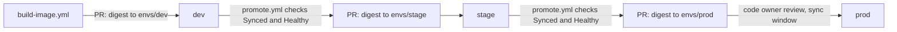

# Promotion by pull request and digest

This record explains how a new image version moves from `dev` to `stage` to `prod`. It is for app owners, reviewers who approve promotions, and operators who run `prod`.

## Context and problem statement

Each environment is a namespace with its own Argo CD Application per app ([ADR 0002](0002-argocd-app-of-apps-with-appprojects.md)). The environment values live in `envs/<env>/<app>/values.yaml` and contain only the image reference and the environment deltas. A new image must reach `dev` quickly, and `stage` and `prod` only after it has proven itself in the previous environment. `prod` changes need a named approver and must not happen at arbitrary times.

How should a version move between environments, and who or what writes the change to Git?

## Decision drivers

- The exact bytes tested in one environment are the bytes deployed in the next.
- Every environment change is a reviewed Git commit; nothing writes to `main` without review.
- A promotion is possible only after the source environment is Synced and Healthy.
- `prod` changes need approval by a code owner and respect a sync window.
- No write access to the cluster from CI.
- Simple to follow for a reviewer who reads the Git history.

## Considered options

- CI writes directly to Git
- Argo CD Image Updater
- Pull request based promotion by digest
- Kargo

## Decision outcome

Chosen option: "Pull request based promotion by digest", because it is the only option in which every environment change is a reviewed commit, the digest is copied rather than rebuilt or re-resolved, and the check of the source environment needs only a read-only token.

The flow:

1. `build-image.yml` builds, signs and pushes the image, then opens a pull request that sets `image.digest` in `envs/dev/<app>/values.yaml`. A human merges it once the checks pass.
2. `promote.yml` runs on manual dispatch. When the repository variable `ARGOCD_SERVER` and the source environment's token are set, it verifies with that read-only Argo CD token that the app's Application in the source environment is Synced and Healthy; otherwise it skips the check and the pull request asks the reviewer to verify the source environment. It then opens a pull request that copies `image.tag` and `image.digest` from `dev` to `stage`, or from `stage` to `prod`. It never syncs imperatively.
3. CODEOWNERS covers `envs/prod/`, so a `prod` promotion needs a code owner's review. The `apps-prod` AppProject has a sync window.
4. The `manifest-generate-paths` annotation on each app Application covers the paths that feed it, so a merged values commit rolls out without a hard refresh.

Nothing auto-merges, not even the `dev` pull request. Kargo is an optional alternative that writes the same keys, decided in [ADR 0012](0012-kargo-promotion.md); this flow stays the default.

### Consequences

- Good, because the same digest moves through all environments; a tag cannot be repointed between test and release.
- Good, because the Git history is the deployment record: who promoted what, when, and who approved it.
- Good, because CI never holds credentials that can change the cluster.
- Good, because a rollback is a revert of the promotion commit.
- Bad, because a human must merge every change, even for `dev`. A team that wants hands-free `dev` deployments must allow the build workflow to commit to `envs/dev/` directly, under a path-scoped exception to the branch rules; the platform does not do this by default.
- Bad, because only the image is promoted. Changes to the app chart, to helm-common or to the chart's base values reach `dev`, `stage` and `prod` in the same merge, limited only by the `prod` sync window.
- Bad, because promotion is per app. Coordinated releases of several apps need several pull requests merged in the right order.
- Bad, because an urgent `prod` fix outside the sync window needs someone with the rights to override the window.
- Neutral, because the Synced and Healthy check proves that the workload runs, not that it is correct. Analysis-based checks need the optional Argo Rollouts toolchain.

### Confirmation

- `promote.yml` fails and opens no pull request when the health check runs and the source Application is not Synced and Healthy. Without `ARGOCD_SERVER` or the token the check is skipped with a warning.
- The CODEOWNERS file covers `envs/prod/`, and the branch rules on `main` require review and the `ci-gate` check. The branch rules are repository settings, outside Git; operators check them after creating the repository.
- The `e2e-kind` job checks that a values commit rolls out without a hard refresh.
- Review: the Renovate configuration and the repository settings enable no auto-merge.

## Pros and cons of the options

### CI writes directly to Git

- Good, because `dev` updates without waiting for a human.
- Bad, because the CI token needs write access to `main` and a bypass of the branch rules.
- Bad, because concurrent builds race on the same file, and changes land without review.

### Argo CD Image Updater

- Good, because it watches the registry and updates Applications without CI changes, optionally writing back to Git.
- Bad, because it tracks the newest image that matches a constraint per Application; it has no notion of promoting a digest that proved itself in a previous environment.
- Bad, because it adds another controller that needs registry access from inside the cluster, with credentials for private registries.

### Pull request based promotion by digest

- Good, because every change is a reviewed commit, and promotion requires a healthy source environment.
- Bad, because it is slower than automated promotion and depends on people merging pull requests.

### Kargo

- Good, because it models stages, verification and promotion state explicitly, and can open pull requests itself.
- Bad, because it adds a controller and its own concepts to learn and operate.
- Neutral, because it can build on the same environment folders; it was added later as an optional engine ([ADR 0012](0012-kargo-promotion.md)).

## More information

Upstream sources, checked on 2026-11-16:

- Argo CD sync windows: <https://argo-cd.readthedocs.io/en/stable/user-guide/sync_windows/>
- Argo CD `manifest-generate-paths`: <https://argo-cd.readthedocs.io/en/stable/operator-manual/high_availability/>
- GitHub code owners: <https://docs.github.com/en/repositories/managing-your-repositorys-settings-and-features/customizing-your-repository/about-code-owners>
- Argo CD Image Updater: <https://argocd-image-updater.readthedocs.io/en/stable/>
- Kargo: <https://docs.kargo.io/>

Related pages and decisions:

- [Promotion and deployment policy](../operations/promotion.md), [CI/CD architecture](../architecture/ci-cd.md), [Add an app](../operations/add-an-app.md)
- [ADR 0002: Argo CD app of apps with AppProjects](0002-argocd-app-of-apps-with-appprojects.md)
- [ADR 0008: keyless image signing](0008-keyless-image-signing.md)
