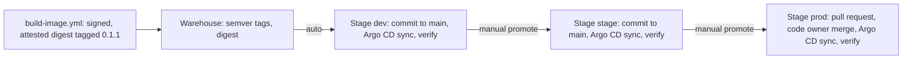

# Kargo as optional promotion orchestration

This record decides how the platform offers stage-aware promotion with verification next to the pull request flow of [ADR 0011](0011-promotion-by-pull-request-and-digest.md). It is for platform maintainers who choose a promotion engine per cluster, and for app owners who promote releases.

## Context and problem statement

[ADR 0011](0011-promotion-by-pull-request-and-digest.md) moves an image digest from `dev` to `stage` to `prod` through pull requests: `build-image.yml` proposes `dev`, `promote.yml` proposes `stage` and `prod`, and a person merges every change. That flow has no dependency beyond GitHub and Argo CD, and it stays the default.

Teams that release often want more: `dev` that follows every release without a merge, a record of which release proved itself in which stage, verification after each promotion instead of a Synced and Healthy check, and one place to see and trigger promotions. They do not want a second deployer: Argo CD stays the only component that applies manifests, and Git stays the record of what runs.

Which tool, if any, should orchestrate promotion, and how does it coexist with `promote.yml` without two writers on the same files?

## Decision drivers

- Purely additive: Argo CD remains the deployer, nothing existing is replaced, and `promote.yml` keeps working with zero extra dependencies.
- The digest that ran and was verified in one stage is the digest promoted to the next.
- Every environment change is a Git commit to `envs/<env>/<app>/values.yaml`, limited to `image.tag` and `image.digest`.
- `prod` changes are reviewed by a code owner.
- Verification uses the same analysis as canary releases (`success-rate`, Argo Rollouts).
- Open source, self-hosted, with SSO on the existing identity provider and the same groups as Argo CD.
- One writer per environment file at any time.

## Considered options

- `promote.yml` only
- Argo CD Image Updater
- Kargo, open source, optional
- Kargo Enterprise (Akuity Platform)

## Decision outcome

Chosen option: "Kargo, open source, optional", because it models stages, the release (Freight) that moves between them and verification as first-class objects, writes the change to Git and lets Argo CD apply it, and does so under the Apache 2.0 licence with self-hosted SSO. It is off by default and on in the `reference` profile only; the workflows `build-image.yml` and `promote.yml` remain the engine of any repository whose cluster files do not enable Kargo, and the zero-dependency fallback.

Version: Kargo v1.12.5, Helm chart `oci://ghcr.io/akuity/kargo-charts/kargo` 1.12.5 (the latest stable release on 2026-11-16; v1.13.0 release candidates exist without a release). API group `kargo.akuity.io/v1alpha1`.

How it is built:

1. Toolchain `kargo` (wrapper chart `helmcharts/system-charts/kargo`, sync wave 4) installs the controller, the API and UI behind the platform Gateway at `kargo.<domain>`, and the webhooks. Its certificates come from cert-manager. All pods run under Pod Security `restricted`; the upstream defaults do not meet it, so the wrapper sets the security context. The controller may patch Argo CD Applications in the Argo CD namespace only (`watchArgocdNamespaceOnly`).
2. Application `kargo-pipelines` (chart `helmcharts/system-charts/kargo-pipelines`, wave 11, after the app Applications so that the first automatic promotion finds them) renders one Kargo Project per app in the inventory (`argocd-bootstrap/values.yaml`, `apps`), named `kargo-<app>`, with a Warehouse and the Stages `dev`, `stage` and `prod`. Repository, registry, Application names and groups come from the cluster definition, so an adopter changes one place.
3. The Warehouse subscribes to `<platform.imageRegistry>/<app>` with a semver constraint. Freight records the digest. `build-image.yml` adds the release tag from `sample-services/<app>/VERSION` only after the scan, the signature and the attestations, so the Warehouse never sees a release that admission would reject.
4. Each promotion clones the repository, sets `image.tag` and `image.digest` in `envs/<env>/<app>/values.yaml`, commits, and then:
   - `dev` and `stage` push to the target branch (`git.targetRevision`);
   - `prod` pushes a branch, opens a pull request and waits until it is merged, so CODEOWNERS and the branch rules apply.
   The last step is `argocd-update` of the matching Application, which asks Argo CD to sync and waits until it runs the new commit. Each hello-api Application carries `kargo.akuity.io/authorized-stage: kargo-<app>:<env>` only when Kargo is enabled, so without Kargo nothing can trigger it.
5. `dev` promotes automatically (ProjectConfig promotion policy); `stage` and `prod` are manual. `stage` accepts only Freight verified in `dev`, `prod` only Freight verified in `stage`.
6. Verification after each promotion references the ClusterAnalysisTemplate `success-rate` of the argo-rollouts toolchain, with the app's Service and namespace as arguments. Kargo creates the AnalysisRun; the Argo Rollouts controller runs it against Prometheus. Verification is on when the `argo-rollouts` and `monitoring` toolchains are both enabled, as in the `reference` profile, and can be forced on or off per cluster. While `monitoring` runs, the app Applications enable the app ServiceMonitor, so the analysis has data. Without verification, a successful promotion counts as verified.
7. SSO: the API uses OIDC with PKCE (no client secret) on the identity provider of Argo CD. `platform.groups.admins` maps to Kargo admin, `viewers` and `deployers` to read access, and `deployers` gets the promoter role in every app Project. The local admin account is off in `reference`; in `lab` it reads its hash and signing key from a Secret.
8. Credentials are Secret references only: a Git credential (and an image credential for a private registry) in the namespace `kargo-shared-resources`, delivered by a SealedSecret in `lab` and an ExternalSecret from OpenBao in `reference`.

### Coexistence with promote.yml

Both engines write the same two keys of the same files, so only one may run per repository. Both workflows run `hack/promotion-engine.sh`, which decides:

| Repository variable `PROMOTION_ENGINE` | Cluster files | Engine | Who writes `envs/dev` | Who writes `envs/stage`, `envs/prod` |
| --- | --- | --- | --- | --- |
| unset | none enables Kargo | workflows | `build-image.yml` opens a pull request | `promote.yml` opens a pull request |
| unset | one enables `toolchains.kargo` with its pipelines | kargo | Kargo (auto-promotion of new release tags) | Kargo (manual promotion; prod through a pull request) |
| `workflows` | any | workflows | as above | as above |
| `kargo` | any | kargo | as above | as above |

With the kargo engine, `build-image.yml` skips its `dev` bump job with a notice and `promote.yml` refuses to run. Enabling Kargo in a cluster file is therefore enough for a single writer; the variable only overrides. Switching back: disable the Kargo pipelines in every cluster file, and delete the variable if it is `kargo`. A reviewer who sees a promotion pull request from the other engine closes it.

Which one to use: `promote.yml` for teams that want every environment change reviewed and nothing extra running in the cluster; Kargo for teams that release often, want `dev` to follow every release, and want verification and a promotion UI. Kargo needs a Git credential with write access inside the cluster, and pushes to the target branch for `dev` and `stage`: with a branch ruleset that requires pull requests on `main`, either give that credential a bypass or set `pullRequest: true` for those stages too.

### Consequences

- Good, because Argo CD stays the only deployer, and every change is still a commit that touches only `image.tag` and `image.digest`.
- Good, because the verified digest is promoted, Kargo shows which release ran and passed where, and an older verified release can be promoted again as a rollback.
- Good, because `dev` follows releases without a human merge, while `prod` keeps code owner review.
- Good, because there is one writer by default: the cluster file that enables Kargo also stops the workflows, so no second switch can be forgotten.
- Good, because verification reuses the canary analysis instead of a second definition of success.
- Bad, because a controller in the cluster holds a Git credential with write access, and its compromise allows commits to the environment files. Scope the credential to this repository and protect `prod` with the pull request flow.
- Bad, because `dev` and `stage` commits skip pull request checks unless the stages use pull requests too.
- Bad, because Kargo adds five workloads, eleven CRDs and its own concepts (Warehouse, Freight, Stage, Promotion) to operate and upgrade, and it publishes no support statement for Kubernetes 1.36 or Argo CD 3.6. The integration test covers this combination on kind.
- Bad, because the engine is per repository, not per cluster: the environment files are shared. While the `reference` cluster file enables Kargo, Kargo is the engine for every cluster of the repository, `lab` included. A repository that wants the pull request flow disables Kargo in its cluster files, or sets `PROMOTION_ENGINE=workflows` and also disables the Kargo pipelines.
- Bad, because verification needs the argo-rollouts and monitoring toolchains, which the `reference` profile therefore enables; without them only the Argo CD sync and health are checked.
- Neutral, because approval steps, promotion windows, notifications and automatic rollback are Kargo Enterprise features. This platform uses the Git pull request and CODEOWNERS for `prod` approval and the Argo CD sync window for timing instead.

### Confirmation

- `tests/integration/kargo/run.sh` on kind, with a local registry and the in-cluster Git server: the Warehouse discovers two release tags, `dev` auto-promotes and the commit lands in Git, Argo CD runs the new digest in `dev`, verification passes, `stage` does not auto-promote, a manual promotion to `stage` works, and `prod` waits for its pull request to be merged.
- `make ci` renders the `kargo` and `kargo-pipelines` charts per profile and validates them with kubeconform; the AppProject `platform` whitelists the cluster-scoped kinds Kargo needs.
- `tests/promotion-engine/run.sh` (`make promotion-engine-test`, in CI) checks the engine rule against fixture cluster files: unset with and without Kargo, Kargo without pipelines, explicit values, invalid values.
- Review: `PROMOTION_ENGINE=workflows` is set only where no cluster runs the Kargo pipelines.

## Pros and cons of the options

### promote.yml only

- Good, because it needs nothing beyond GitHub and Argo CD, and every change is reviewed.
- Bad, because `dev` needs a merge per release, verification is a Synced and Healthy check, and there is no view of which release passed which stage.

### Argo CD Image Updater

- Good, because it is small and integrates with Argo CD Applications.
- Bad, because it tracks the newest matching image per Application; it has no stages, no notion of a release that proved itself upstream, and no verification.
- Bad, because its write-back changes Application parameters or a separate file, not the environment values this platform reviews.

### Kargo, open source, optional

- Good, because stages, Freight, verification with Argo Rollouts analysis, Git write-back, pull requests for selected stages and SSO are in the open source edition.
- Bad, because it adds an in-cluster controller with Git write credentials and its own concepts.

### Kargo Enterprise (Akuity Platform)

- Good, because it adds approvals, promotion windows, notifications, automatic rollback and a managed control plane.
- Bad, because it is a commercial dependency for a public reference platform, and the features it adds are covered here by pull requests, CODEOWNERS and sync windows.

## More information

Upstream sources, checked on 2026-11-16:

- Releases and chart: <https://github.com/akuity/kargo/releases/tag/v1.12.5>, chart values <https://github.com/akuity/kargo/blob/v1.12.5/charts/kargo/values.yaml>
- Promotion steps (git-clone, yaml-update, git-commit, git-push, git-open-pr, git-wait-for-pr, argocd-update; providers github, gitlab, gitea, azure, bitbucket): <https://docs.kargo.io/user-guide/reference-docs/promotion-steps/>
- Argo CD integration and `kargo.akuity.io/authorized-stage`: <https://docs.kargo.io/user-guide/how-to-guides/argo-cd-integration>
- Verification with AnalysisTemplates and ClusterAnalysisTemplates: <https://docs.kargo.io/user-guide/how-to-guides/verification>
- Auto-promotion through ProjectConfig: <https://docs.kargo.io/user-guide/how-to-guides/working-with-projects>
- OpenID Connect and access control: <https://docs.kargo.io/operator-guide/security/openid-connect/>, <https://docs.kargo.io/user-guide/security/access-controls>
- Credentials: <https://docs.kargo.io/user-guide/security/managing-secrets>

Related pages and decisions:

- [Promote with Kargo](../how-to/promote-with-kargo.md), [Promotion and deployment policy](../operations/promotion.md)
- [ADR 0008: keyless image signing](0008-keyless-image-signing.md), [ADR 0011: promotion by pull request and digest](0011-promotion-by-pull-request-and-digest.md)
