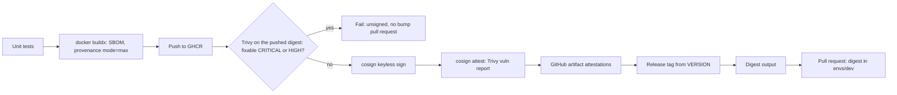

# CI/CD

This page describes the GitHub Actions workflows that validate every change, build and sign images, promote them between environments and test the platform end to end on kind. It is for contributors who change the repository and for reviewers who want to know what a green check proves.

## Workflows

GitHub Actions is the reference CI. Jenkins is an optional on-premises adapter (see [Jenkins](#jenkins-as-an-optional-on-premises-adapter)).

| Workflow | Purpose |
| --- | --- |
| `.github/workflows/validate.yml` | Static validation of every change; ends in the required check `ci-gate` |
| `.github/workflows/e2e.yml` | Nightly and on-demand end-to-end run of the `lab` profile on kind, with a diagnostics upload; the per-pull-request run is the job `e2e-kind` of `validate.yml` |
| `.github/workflows/build-image.yml` | On `main`: tests, builds, pushes, scans, signs and attests the sample service image, then opens the dev digest pull request. On pull requests: tests, builds and scans without pushing |
| `.github/workflows/promote.yml` | Opens a promotion pull request from dev to stage, or from stage to prod, on manual dispatch |
| `.github/workflows/scorecard.yml` | OpenSSF Scorecard analysis of the repository |
| `.github/workflows/dependency-review.yml` | Review of dependency changes in pull requests |

## Validation pipeline

`validate.yml` runs on every pull request, in the merge queue, on pushes to `main`, weekly and on manual dispatch (see [pull requests opened by workflows](#pull-requests-opened-by-workflows)). The `secrets` job also runs a full-history scan on a weekly schedule.

| Job | What it checks | Tools |
| --- | --- | --- |
| `workflow-lint` | Workflow syntax and expressions; workflow security issues such as template injection, broad permissions and unpinned actions | actionlint, zizmor |
| `secrets` | No secret in the change; the weekly run scans the full history; no committed `kind: Secret` with `data` or `stringData` outside Helm `templates/` directories and `*.example.yaml` files | gitleaks, `hack/secrets.sh` |
| `commit-lint` | Commit subjects of the pull request follow Conventional Commits | `make lint-commits` |
| `yaml-lint` | YAML syntax and style with the repository configuration, excluding Helm `templates/` | yamllint |
| `docs` | Markdown style; local links and anchors in every file; external links in the Markdown files that a pull request changes, and in every file on `main`, weekly and on manual dispatch | markdownlint, lychee |
| `shell-lint` | Shell script defects and formatting | shellcheck, shfmt |
| `config` | Every `clusters/*/cluster.yaml` validates against `clusters/schema.json`, every `tenants/*.yaml` against `tenants/schema.json`, and both pass the consistency checks; placeholders such as `CHANGE_ME` and `YOUR_` are reported as warnings, because the shipped files keep them until an operator fills them in | `hack/validate-config.sh` |
| `ansible` | Lint on the production profile, playbook syntax, role behaviour | ansible-lint, `ansible-playbook --syntax-check`, Molecule |
| `opentofu` | Formatting, `tofu validate`, and the offline `tofu test` suite with a mocked provider for every module under `infra/` | OpenTofu |
| `helm` | Dependency build and `helm lint --strict` of every chart for each profile; the helm-unittest suites of the charts and of the argocd-bootstrap templates (pull request previews, image signing identity) | Helm, helm-unittest |
| `argocd-bootstrap` | Renders every Application and chart for each profile, in both rendering modes; validates the output against the Kubernetes schemas of the profile version and of 1.35 and against the CRD schemas; Application names are unique; referenced paths exist; every rendered kind and namespace is permitted by its AppProject; the support matrix is current | Helm, kubeconform |
| `policy-test` | Kyverno test fixtures (pods that must be admitted and pods that must be denied), and the rendered policies applied to every rendered app and environment | Kyverno CLI |
| `policy-test-attestations` | The vulnerability attestation gate of the image verification policy, against images signed and attested with an ephemeral key in a throwaway local registry (see [the test README](../../helmcharts/system-charts/kyverno-policies/tests/vuln-attestation/README.md)) | Kyverno CLI, cosign, Docker |
| `dockerfile-lint` | Dockerfile rules, and a smoke test that starts the image and checks `/readyz` and `/metrics` | hadolint, Docker |
| `trivy-config` | Misconfiguration scan of the rendered manifests; fails on findings; every ignore entry carries an expiry date; results are uploaded as SARIF | Trivy |
| `jenkins-lint` | The optional Jenkins pipelines pass the declarative linter | Jenkins linter in a pinned container |
| `e2e-kind` | The end-to-end test on kind (see [end-to-end test](#end-to-end-test)) | kind, `make demo` |
| `ci-gate` | Every job above succeeded | GitHub Actions `needs:` |

### The `ci-gate` aggregator

`ci-gate` lists every other job in `needs:`, runs with `if: always()`, and fails if any of them failed. It is the only required status check on `main`.

One aggregated check keeps the branch rule stable when jobs are added, renamed or split into a matrix. `if: always()` is required because GitHub reports a skipped job as successful, and a skipped required check does not block a merge ([using conditions to control job execution](https://docs.github.com/en/actions/using-jobs/using-conditions-to-control-job-execution)). Without it, a failed dependency would skip the gate and the pull request would pass.

### Workflow hardening

- Every action is pinned by its full commit SHA, with the version in a comment. A tag can be moved to different code, and that code would run with the job's permissions ([security hardening for GitHub Actions](https://docs.github.com/en/actions/security-guides/security-hardening-for-github-actions)). Renovate updates the SHA and the comment together.
- `validate.yml` grants `contents: read` in its top-level `permissions` block; the other workflows set `permissions: {}` and grant every permission at job level. A job that needs more requests it at job level, and only that permission: for example `security-events: write` to upload SARIF, `id-token: write` for keyless signing, `packages: write` to push to GHCR, or `actions: write` to dispatch `validate.yml`.
- Every job has `timeout-minutes`, and a `concurrency` group keeps one active run per branch.

### Running the checks locally

Most jobs have a Make target that runs the same check, for example `make validate-config`, `make policy-test`, `make ansible-lint`, `make molecule`, `make render` and `make kubeconform`. The tool versions are pinned in `mise.toml` and `.devcontainer/devcontainer.json`, and `pre-commit` hooks run the fast checks before each commit. The full list is in [make targets](../reference/make-targets.md).

## Build pipeline

`build-image.yml` builds the images defined by `sample-services/*/Dockerfile`, at present `hello-api`. On `main` the steps run in this order:

1. Run the unit tests of the service.
2. Build the image with `docker buildx` for every platform, with an SBOM attestation and provenance in `mode=max`, and push it to GHCR.
3. Scan the pushed digest with Trivy. When it finds a CRITICAL or HIGH vulnerability that has a fix available, the job fails: the image stays in GHCR unsigned, and the steps below do not run.
4. Sign the pushed digest with cosign keyless signing, using the workflow's GitHub OIDC identity.
5. Attest the full Trivy report of the digest with cosign keyless (predicate type `vuln`, same identity as the signature).
6. Create GitHub artifact attestations for the build provenance and the SBOM, and verify the signature and the vulnerability attestation.
7. When `sample-services/<app>/VERSION` holds a semantic version that is not yet a tag of the image, tag the digest with it. Existing version tags are never moved; Kargo Warehouses subscribe to these tags.
8. Output the digest, and open a pull request that sets `image.digest` in `envs/dev/<app>/values.yaml`, unless Kargo is the promotion engine: the repository variable `PROMOTION_ENGINE` is `kargo`, or it is unset and a cluster file enables Kargo (`hack/promotion-engine.sh`, [ADR 0012](../adr/0012-kargo-promotion.md)).

A failed image never reaches an environment through the bump pull request, and `stage` and `prod` admission in the `reference` profile rejects it because it is unsigned and has no vulnerability attestation. On pull requests the workflow runs the tests, builds a single-platform image into the runner and scans it; nothing is pushed.

A daily scheduled run (and a manual dispatch with `rescan`) only scans the digests pinned in `envs/{dev,stage,prod}/<app>/values.yaml` again and attests the result, so the admission check on the scan age keeps admitting deployed images that still have no CRITICAL finding, and stops admitting new pods of a digest that gained one.

### Outputs

| Output | Location | Consumer |
| --- | --- | --- |
| Image, addressed by digest | `ghcr.io/your-org/<app>@sha256:<digest>` | Environment values files, then Argo CD |
| SBOM and provenance attestations | Attached to the image in GHCR | Supply-chain review |
| cosign signature | GHCR, next to the image | Kyverno `ImageValidatingPolicy` in `stage` and `prod` (`reference` profile) |
| cosign vulnerability attestation | GHCR, next to the image; renewed daily for deployed digests | The same policy: no CRITICAL finding, scan not older than `maxScanAge` |
| Release tag | `ghcr.io/your-org/<app>:<version>` | Kargo Warehouse (optional) |
| GitHub artifact attestation | Attestations of the repository on GitHub | Verification with the GitHub CLI |
| Digest | Workflow output | The dev digest pull request |

Every deployment references the image by digest, so the image that runs in `prod` is byte for byte the image that was scanned, signed and run in `dev` and `stage`.

### Signing identity

Keyless signing binds the signature to the identity of the workflow run instead of a long-lived key. The admission policy accepts a signature only with this identity:

| Field | Value |
| --- | --- |
| OIDC issuer | `https://token.actions.githubusercontent.com` |
| Certificate subject (regular expression) | `^https://github\.com/[^/]+/sk-k8s-devops-bootstrap/\.github/workflows/build-image\.yml@refs/heads/main$` |

The subject names the workflow file and the ref. Only a run of `build-image.yml` on `main` produces an accepted signature; a build from another branch, a pull request or a workstation does not.

The Kyverno policy reads the identity from the values `imageVerification: {enabled, issuer, subjectRegExp, registries}`. Verification is enabled for `stage` and `prod` in the `reference` profile and disabled in `lab`, because the kind demo loads a locally built, unsigned image.

Interpretation: the expression accepts any repository owner (`[^/]+`), so a fork with the same repository name can produce a matching subject. The registry allowlist of the workload contract and the `registries` value keep such images out, because a fork cannot push to `ghcr.io/your-org`.

Recommendation: in your own deployment, replace `[^/]+` with your organisation name, so that both the identity and the registry pin the owner.

How to verify a signature and an attestation by hand is described in [supply chain](../security/supply-chain.md). See also [ADR 0008](../adr/0008-keyless-image-signing.md).

## Promotion

An image moves through the environments only by pull request and only by digest:

1. `build-image.yml` opens a pull request that bumps `image.digest` in `envs/dev/<app>/values.yaml`. A maintainer merges it after the checks pass.
2. `promote.yml`, started by manual dispatch, first checks with a read-only Argo CD token that the Application is Synced and Healthy in the source environment, when the repository variable `ARGOCD_SERVER` and that environment's token are set; otherwise it skips the check and the pull request asks the reviewer to verify the source environment. It then opens a pull request that copies the digest from dev to stage, or from stage to prod. It never triggers a sync itself.
3. CODEOWNERS covers `envs/prod/`. With code owner review required on `main`, a prod promotion cannot merge without an owner's approval. Prod applies the change inside its [sync window](gitops.md#prod-sync-window).

Nothing auto-merges at any step. The runbook, including the deployment policy, is [promotion](../operations/promotion.md); the decision is [ADR 0011](../adr/0011-promotion-by-pull-request-and-digest.md).

### Pull requests opened by workflows

A pull request created with the `GITHUB_TOKEN` of a workflow run does not start other workflows ([triggering a workflow from a workflow](https://docs.github.com/en/actions/using-workflows/triggering-a-workflow#triggering-a-workflow-from-a-workflow)). Without a countermeasure, `validate.yml` would not run on the dev digest and promotion pull requests, and `ci-gate` would never report on them. `build-image.yml` and `promote.yml` handle this in one of two ways:

- When the repository variable `GITOPS_APP_ID` and the secret `GITOPS_APP_PRIVATE_KEY` exist, they create the pull request with a GitHub App installation token from `actions/create-github-app-token`, pinned by SHA like every action. Pull requests created with that token start `validate.yml` as usual.
- Otherwise they create the pull request with `GITHUB_TOKEN` and then run `gh workflow run validate.yml --ref <branch>`, which needs `actions: write`. `validate.yml` has a `workflow_dispatch` trigger for this, so `ci-gate` reports on the head commit of the pull request.

Creating the GitHub App, installing it on the repository and storing its ID and private key are owner actions; the workflows do not create them.

## End-to-end test

The job `e2e-kind` runs on every pull request in `validate.yml`, and nightly and on demand in `e2e.yml`. It brings up the lab with `make demo`:

- a kind cluster with one control plane and two workers, using a CNI that enforces NetworkPolicy;
- Argo CD installed once and then self-managed, with the root Application of the `lab` cluster;
- the `lab` profile, with self-signed certificates and `*.localtest.me` hostnames;
- a locally built `hello-api` image loaded into the cluster.

It then asserts that:

- every Argo CD Application is Synced and Healthy within a time budget;
- `hello-api` answers through the Gateway `platform`;
- a privileged pod, a pod that runs as root and a pod with a `latest` image tag are denied;
- traffic from one app namespace to another is blocked;
- a commit that changes only a values file rolls out without a hard refresh, which proves the `manifest-generate-paths` annotations.

The assertions run through `make e2e` (`hack/e2e/run.sh`), which brings the demo up itself and deletes the cluster at the end. To reproduce a failure locally and keep the cluster for inspection, run `KEEP=1 make e2e`, or run `make demo` and then `SKIP_UP=1 KEEP=1 make e2e`; remove the cluster with `make demo-down` (see [quick start](../getting-started/quick-start.md)).

This job does not cover what kind cannot exercise: the RKE2 node configuration and high availability, etcd snapshots, image signature verification (disabled in `lab`), SSO, and ACME certificates.

## Dependency updates and repository health

Renovate opens pull requests for chart dependencies of the wrapper charts, GitHub Actions digests, Dockerfile base images and pinned tool versions. Nothing auto-merges: each update passes `ci-gate`, including the end-to-end test, and a maintainer merges it. Component versions appear in the documentation only in the generated [support matrix](../reference/support-matrix.md), so an update does not require edits to prose.

`scorecard.yml` runs [OpenSSF Scorecard](https://github.com/ossf/scorecard), which rates repository practices such as branch protection, pinned dependencies and token permissions. The results are uploaded as SARIF and published for the badge in the README.

`dependency-review.yml` runs on pull requests and reports dependency changes that introduce packages with known vulnerabilities. It is a separate workflow and not part of `ci-gate`.

## Jenkins as an optional on-premises adapter

For organisations that must build on their own infrastructure, the repository includes an optional Jenkins adapter. `make install-jenkins` runs the playbook `ansible/playbooks/jenkins_setup.yml` with the role `ansible/roles/install_jenkins`. Each job type has one declarative Jenkinsfile under `ci/jenkins/pipelines/`, run from SCM inside the Groovy sandbox, and Job DSL generates a build and a promote job for every service in `ci/jenkins/services.yaml` (see `ci/jenkins/README.md`). Builds run on Kubernetes agents with rootless BuildKit; the controller has zero executors, credentials are JCasC file secrets, and TLS terminates in front of Jenkins. The `jenkins-lint` job lints the pipelines on every pull request. Jenkins does not gate merges: `ci-gate` does. Jenkins signs its images with a cosign key pair, not with the GitHub Actions identity. Interpretation: in the `reference` profile such images are admitted only where verification is off, which is `dev`, unless the verification policy is extended to trust the Jenkins public key. See [ADR 0009](../adr/0009-github-actions-reference-ci-jenkins-optional.md).

## Related

- [Architecture overview](overview.md)
- [GitOps with Argo CD](gitops.md)
- [Supply chain](../security/supply-chain.md)
- [Security controls](../security/controls.md)
- [ADR 0008: Keyless image signing](../adr/0008-keyless-image-signing.md)
- [ADR 0009: GitHub Actions as reference CI, Jenkins optional](../adr/0009-github-actions-reference-ci-jenkins-optional.md)
- [ADR 0011: Promotion by pull request and digest](../adr/0011-promotion-by-pull-request-and-digest.md)
