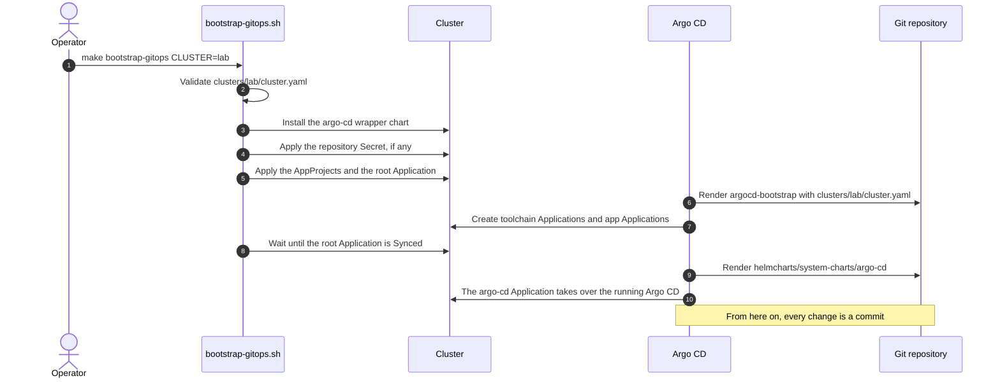
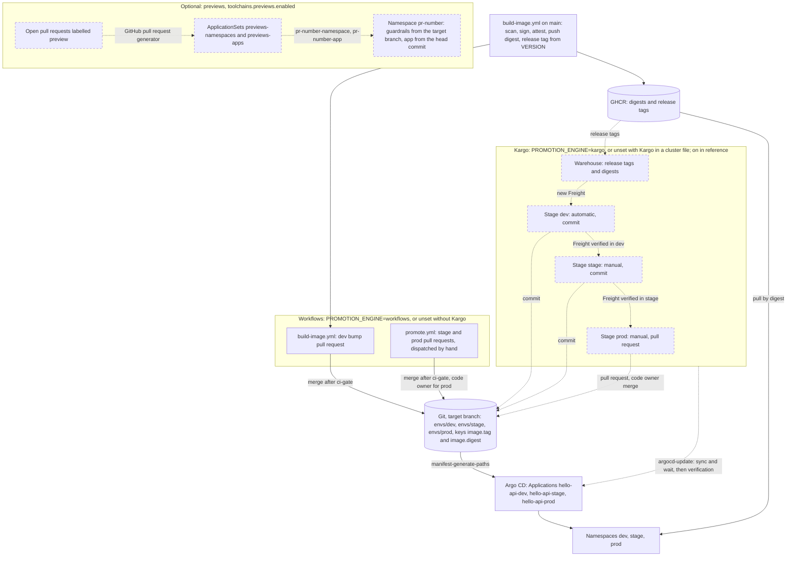

# GitOps with Argo CD

This page explains how Argo CD is bootstrapped, how the app of apps renders the platform, the workloads and the optional pull request previews, how AppProjects, sync waves and values layering keep the result ordered and bounded, and how the two promotion paths change what runs. It is for operators and contributors who change what runs in a cluster.

## Bootstrap

One command takes an empty cluster to a cluster that Argo CD manages from Git. From then on Argo CD also manages itself from Git.

`make bootstrap-gitops CLUSTER=<name>` runs `hack/bootstrap-gitops.sh`, which:

1. Validates `clusters/<name>/cluster.yaml` with `hack/validate-config.sh`.
2. Installs Argo CD with `hack/argocd-install.sh`: the wrapper chart `helmcharts/system-charts/argo-cd`, which wraps the upstream OCI chart, with `values.yaml` and `values-<profile>.yaml`. `SKIP_ARGOCD_INSTALL=1` skips this step when Argo CD already runs.
3. Applies the repository Secret from `REPO_SECRET_FILE`, when it is set: a file outside the repository, or a SOPS-encrypted `*.sops.yaml` that the script decrypts. The template is `bootstrap/repo-secret.example.yaml`. A public repository needs no Secret.
4. Applies the AppProjects rendered by `argocd-bootstrap`, because the root Application belongs to the project `platform`.
5. Applies the root Application `root`, rendered by the Helm chart `bootstrap/` from `bootstrap/templates/root-app.yaml`.
6. Waits until the root Application is Synced. `WAIT=0` skips the wait; `WAIT_TIMEOUT` defaults to 600s.

The root Application renders the `argocd-bootstrap` chart with its `values.yaml` and then `clusters/<name>/cluster.yaml`. It belongs to the project `platform`, syncs automatically with prune and self-heal, and carries no resources finalizer, so deleting it never cascades into the platform. `argocd-bootstrap` renders the AppProjects, which Argo CD now owns, one Application per enabled toolchain, including `argo-cd`, and one Application per app and environment. The `argo-cd` Application renders the same wrapper chart and takes over the resources that step 2 created. From this point an Argo CD upgrade or configuration change is a commit to `helmcharts/system-charts/argo-cd`.

The script is idempotent. It takes these overrides:

| Variable | Effect |
| --- | --- |
| `REPO_URL` | Repository Argo CD reads, for a fork or while the cluster file still holds the `YOUR_ORG` placeholder |
| `TARGET_REVISION` | Branch, tag or commit; the end-to-end job passes the commit under test |
| `REPO_SECRET_FILE` | Repository Secret for a private repository (step 3) |
| `HUB_MODE=1` | Adds the ApplicationSet for remote clusters (see [hub mode](#hub-mode)) |
| `SKIP_ARGOCD_INSTALL=1` | Skips step 2 |
| `WAIT=0`, `WAIT_TIMEOUT` | Skip or bound the wait in step 6 |
| `RENDER_ONLY=1` | Prints the AppProjects and the root Application and exits |
| `DRY_RUN=1` | Prints the kubectl commands instead of running them |

`REPO_URL` and `TARGET_REVISION` land in the root Application's `valuesObject.git`, so every child Application follows the same repository and revision. The root Application is not managed by itself: a change to the `bootstrap/` chart or to the git settings is applied by running `make bootstrap-gitops` again. Everything below the root is reconciled by Argo CD.

`make install-argocd PROFILE=<lab|reference>` still runs `hack/argocd-install.sh` alone, to install or reinstall Argo CD without the rest. It is not a step before `make bootstrap-gitops`. `make demo` runs the same bootstrap on a kind cluster with the `lab` profile.



The imperative steps exist only because Argo CD cannot deploy itself before it runs. After the hand-over the install script is not part of the change path, and there is one source for the Argo CD configuration. Upgrades follow [upgrade Argo CD](../operations/upgrade-argocd.md). The UI is served at `argocd.<domain>` through an HTTPRoute on the Gateway `platform`; access control per profile is described in [Argo CD SSO](../security/argocd-sso.md).

### Hub mode

The bootstrap chart also implements a two-cluster topology: one hub Argo CD that manages remote clusters as well as its own. Each remote cluster gets its own definition, for example `clusters/prod/cluster.yaml` with `cluster.destination.name` set to the name under which it is registered in the hub and `cluster.environments` listing the environments it hosts. With `HUB_MODE=1`, the bootstrap adds the ApplicationSet `clusters` (`bootstrap/templates/clusters-applicationset.yaml`), which creates one root Application `root-<name>` per registered cluster that carries the label `cluster-definition`. The objects of a remote cluster are prefixed with its name, so several clusters share one Argo CD namespace without collisions.

Hub mode is implemented in the bootstrap chart and not tested in CI. The procedure is in [`bootstrap/README.md`](../../bootstrap/README.md).

## The app of apps

`argocd-bootstrap/` is a Helm chart whose output is Argo CD objects. Its values come from three layers, lowest precedence first:

1. `argocd-bootstrap/values.yaml`: defaults, the core toolchain switches, the `projects:` settings and the `apps:` list.
2. `clusters/<name>/cluster.yaml`: the facts of one cluster and its toolchain switches. It overrides the defaults.
3. The root Application's `valuesObject`: the git overrides given at bootstrap.

Every template can use `.Values.git.*` (repository URL and revision), `.Values.cluster.*` (name, profile, domain), `.Values.namespaces.*`, `.Values.platform.*` and `.Values.toolchains.*`.

| Output | Rendered from | Wave | Count |
| --- | --- | --- | --- |
| AppProjects `platform`, `apps-<env>` and the locked `default` | `argocd-bootstrap/templates/projects/` | `-1` | One per project |
| Toolchain Application | `argocd-bootstrap/templates/toolchains/<name>.yaml`, guarded by `toolchains.<name>.enabled` | `0` to `4` | One per enabled toolchain |
| Application `cluster-secrets` | `argocd-bootstrap/templates/cluster/secrets.yaml`, guarded by `toolchains.cluster-secrets.enabled`; applies `clusters/<name>/secrets/` | `1` | At most one |
| AppProject `tenants` and ApplicationSet `tenants` | `argocd-bootstrap/templates/tenants/applicationset.yaml`, guarded by `toolchains.tenants.enabled` (off by default); the ApplicationSet creates one Application `tenant-<name>` per `tenants/<name>.yaml`, which renders `tenants/chart` | `-1` (AppProject), `3` (ApplicationSet) | At most one each; two ApplicationSets in hub mode |
| App Application (static mode, default) | `apps:` list | `10` | One per app and environment |
| ApplicationSet (ApplicationSet mode) | `apps:` list | `10` | One per environment, generating the same Applications |
| Application `kargo-pipelines` | `argocd-bootstrap/templates/toolchains/kargo.yaml`, guarded by `toolchains.kargo.enabled` (on in `reference`) and `toolchains.kargo.pipelines.enabled` (default true); renders `helmcharts/system-charts/kargo-pipelines` | `11` | At most one; see [promotion paths](#promotion-paths) |
| AppProjects `apps-preview`, `preview-namespaces` and ApplicationSets `previews-namespaces`, `previews-apps` | `argocd-bootstrap/templates/previews/`, guarded by `toolchains.previews.enabled` (off by default) | `-1` (AppProjects), `10` (ApplicationSets) | Two of each when enabled; see [pull request previews](#pull-request-previews) |

### Toolchain Applications

Every toolchain template follows one convention:

- The Application name and the Helm release name are the toolchain name. The Application name comes from the helper `argocd-bootstrap.name`, which prefixes it with the cluster name in [hub mode](#hub-mode).
- The project is `platform`, through the helper `argocd-bootstrap.platformProject`. The destination comes from the helper `argocd-bootstrap.destination`, which renders the in-cluster server or, in hub mode, the registered cluster name.
- The source path is `helmcharts/system-charts/<name>`, for the `misc` toolchain `helmcharts/system-charts/misc`.
- The value files are `values.yaml` and `values-<profile>.yaml`, with `ignoreMissingValueFiles: true` so a wrapper chart without a profile delta still renders. Cluster-specific values from `toolchains.<name>.values` in the cluster file are passed as `helm.valuesObject`.
- `CreateNamespace=true` creates the component namespace, and `managedNamespaceMetadata` sets Pod Security Standards labels suited to that component.
- `ServerSideApply=true`, automated prune and self-heal, and a retry with exponential backoff.
- A sync wave annotation, and `manifest-generate-paths: "."`.
- The finalizer `resources-finalizer.argocd.argoproj.io`, so deleting the Application deletes what it deployed, except objects marked `Delete=false`. The `argo-cd` Application is the exception: it carries no resources finalizer, so deleting it never deletes Argo CD.

A trimmed example, the cert-manager toolchain:

```yaml
{{- if (dig "cert-manager" "enabled" false .Values.toolchains) }}
apiVersion: argoproj.io/v1alpha1
kind: Application
metadata:
  name: {{ include "argocd-bootstrap.name" (list . "cert-manager") }}
  namespace: {{ .Values.namespaces.argocd }}
  annotations:
    argocd.argoproj.io/sync-wave: "0"
    argocd.argoproj.io/manifest-generate-paths: "."
  finalizers: [resources-finalizer.argocd.argoproj.io]
spec:
  project: {{ include "argocd-bootstrap.platformProject" . }}
  source:
    repoURL: {{ .Values.git.repoURL }}
    targetRevision: {{ .Values.git.targetRevision }}
    path: helmcharts/system-charts/cert-manager
    helm:
      releaseName: cert-manager
      valueFiles: [values.yaml, values-{{ .Values.cluster.profile }}.yaml]
      ignoreMissingValueFiles: true
  destination:
    {{- include "argocd-bootstrap.destination" . | nindent 4 }}
    namespace: {{ .Values.namespaces.certManager }}
  syncPolicy:
    automated: {prune: true, selfHeal: true}
    syncOptions: [CreateNamespace=true, ServerSideApply=true]
    retry: {limit: 10, backoff: {duration: 10s, factor: 2, maxDuration: 5m}}
{{- end }}
```

Core toolchains default to enabled in `argocd-bootstrap/values.yaml`. Optional toolchains default to disabled and are enabled per cluster in `clusters/<name>/cluster.yaml`:

```yaml
toolchains:
  monitoring: {enabled: true}
  velero: {enabled: true}
```

A new toolchain that renders a cluster-scoped kind must also add that kind to the whitelist of the `platform` project. Without it the sync fails with a permission error.

### App Applications

Apps are listed once, in `argocd-bootstrap/values.yaml`:

```yaml
apps:
  - name: hello-api
    chart: helmcharts/app-charts/hello-api
    environments: [dev, stage, prod]
```

For each app and environment hosted by the cluster (`cluster.environments`), the chart renders one multi-source Application named `<app>-<env>`:

- source 1: the app chart, with the value files `values.yaml` of the chart, then `$values/envs/<env>/<app>/values.yaml`;
- source 2: the same repository with `ref: values`, which provides `$values`;
- `helm.valuesObject.global` with `environment`, `domain`, `cluster` and `profile` from the cluster definition, so an environment file stays independent of the cluster;
- project `apps-<env>`, destination namespace `<env>` and `CreateNamespace=false`;
- sync wave `10`;
- a `manifest-generate-paths` annotation that covers every path the render depends on (see [below](#manifest-generate-paths-in-a-monorepo)).

The namespaces `dev`, `stage` and `prod` are not created by the app Applications. The `misc` toolchain owns them at an earlier wave, with their Pod Security Standards labels, LimitRange and ResourceQuota. The steps to add an app are in [add an app](../operations/add-an-app.md).

### ApplicationSet mode

`applicationSet.enabled: true` replaces the static app Applications with one ApplicationSet `apps-<env>` per environment, which generates the same Application names and specs from the same `apps:` list. Static app Applications render only when the flag is false, so the two modes never produce duplicate Applications. The ApplicationSets use `goTemplate` with `missingkey=error`, so a missing value fails the render instead of producing an empty field, and `preserveResourcesOnDeletion`, so deleting or disabling an ApplicationSet leaves the running workloads in place. The `prod` ApplicationSet uses `applicationsSync: create-update`, so the controller never deletes a `prod` Application. Switching modes on a running cluster follows the procedure in [`argocd-bootstrap/README.md`](../../argocd-bootstrap/README.md).

The modes differ in review and ordering:

| Aspect | Static mode (default) | ApplicationSet mode |
| --- | --- | --- |
| Review | Every Application appears in the rendered output of `make render` and in a diff | The diff shows the generator; the generated Applications appear only in the cluster |
| Ordering | App Applications are children of the root Application and take part in its sync waves | The ApplicationSet controller owns the generated Applications; the root Application's waves order the ApplicationSet objects, not each generated Application |
| Scale | One rendered object per app and environment | One object per environment, regardless of the number of apps |

Recommendation: keep static mode while the list of apps and environments stays small enough to review in a diff. Switch to ApplicationSet mode when that list grows. Hub mode uses a cluster generator for the root Applications of remote clusters, not for the app Applications; see [hub mode](#hub-mode).

### Pull request previews

Previews are optional and off by default. With `toolchains.previews.enabled: true` in the cluster file, `argocd-bootstrap/templates/previews/` renders two AppProjects at wave `-1` and two ApplicationSets at wave `10`. Both ApplicationSets use the GitHub pull request generator, which polls the repository every `previews.requeueAfterSeconds` (300 seconds by default) and returns the open pull requests that carry every label in `previews.github.labels` (default `preview`). By default it authenticates with a read-only token from the Secret `github-previews` in the Argo CD namespace; `previews.github.appSecretName` switches to a GitHub App.

| ApplicationSet | Generates per pull request | Project | Source revision |
| --- | --- | --- | --- |
| `previews-namespaces` | `pr-<number>-namespace`: Namespace `pr-<number>` with Pod Security `restricted`, ResourceQuota, LimitRange, `default-deny` and `allow-dns`, from `helmcharts/app-charts/preview-namespace` | `preview-namespaces` | `git.targetRevision` |
| `previews-apps` | `pr-<number>-<app>` per entry in `previews.apps`: the app chart with `values.yaml`, `envs/dev/<app>/values.yaml` and `envs/preview/<app>/values.yaml` | `apps-preview` | The pull request head commit |

The split follows trust: the guardrails of a preview namespace come from the target branch, the workload from the pull request, which is untrusted input. `apps-preview` may deploy only into `pr-*` namespaces, no cluster-scoped kinds and none of the blacklisted namespaced kinds of the `apps-<env>` projects. The templates use only `.number` and `.head_sha` from the generator, never the branch name or title.

Unlike ApplicationSet mode, the preview ApplicationSets delete what they generated: `preserveResourcesOnDeletion` is false and every generated Application carries the resources finalizer. Closing or merging the pull request, or removing the label, deletes both Applications and with them Namespace `pr-<number>`. By default a preview runs the image tag and digest of `envs/dev/<app>/values.yaml` as of the head commit, so it previews chart and values changes, not application code. Setup, hostnames and the security model are in [preview environments](../how-to/preview-environments.md).

## AppProjects and the tenancy boundary

An AppProject defines what its Applications may deploy, from where and to where. Argo CD rejects an Application sync that renders a kind or a destination its project does not permit.

The AppProjects are rendered by `argocd-bootstrap/templates/projects/` at sync wave `-1`, before any Application that uses them.

| Project | Used by | Destinations | Cluster-scoped kinds | Namespaced kinds |
| --- | --- | --- | --- | --- |
| `platform` | Root Application and all toolchain Applications, including `kargo` and `kargo-pipelines` | Every value of `namespaces` plus `projects.platform.extraDestinationNamespaces`; this includes the app namespaces for the objects `misc` and `network-policies` own there, and the Kargo Project namespaces `kargo-<app>` when the Kargo pipelines are enabled | Enumerated whitelist `projects.platform.clusterResourceWhitelist`, for example CRDs, webhook configurations, ClusterRole, ClusterRoleBinding, GatewayClass, StorageClass, Namespace and the Kargo `Project` | All |
| `apps-dev`, `apps-stage`, `apps-prod` | App Applications of one environment | One namespace: `dev`, `stage` or `prod` | None | All except the blacklist `projects.apps.namespaceResourceBlacklist`: ResourceQuota, LimitRange, Role and RoleBinding |
| `apps-preview` (previews only) | Preview app Applications `pr-<number>-<app>` | `pr-*` | None | All except the same blacklist as the app projects |
| `preview-namespaces` (previews only) | Preview namespace Applications `pr-<number>-namespace` | `pr-*` | Namespace | ResourceQuota, LimitRange and NetworkPolicy only |
| `default` | Nothing | None | None | None |

The app projects accept only this repository (`git.repoURL`) as a source; the `platform` project accepts it plus the repositories in `projects.extraSourceRepos`. `default` is locked with no sources and no destinations, so an Application that omits its project or names `default` cannot deploy anything.

Each app project defines three project roles: `deployers` (get and sync, bound to the deployers group), `viewers` (get, bound to the viewers group) and `ci` (get, for `argocd app wait` in CI with short-lived tokens from `argocd proj role create-token`). The `platform` project grants the admins group every action and the viewers and deployers groups get.

### Why app projects are restricted

The app projects are the tenancy boundary between environments and between apps and the platform. Each restriction closes a specific path:

- Cluster-scoped kinds act on the whole cluster. A ClusterRoleBinding in an app chart would turn every app commit into an administrator action, and a CRD or webhook could change the behaviour of every namespace.
- ResourceQuota and LimitRange are the resource bounds of the namespace. An app that can write them can lift its own limits.
- NetworkPolicy is not blacklisted, because each app renders its own NetworkPolicy through helm-common. The platform keeps `default-deny` and `allow-dns` in each app namespace through the `network-policies` toolchain, in the `platform` project. NetworkPolicies are additive, so an app policy can open traffic to the pods it selects in its own namespace but cannot remove the default deny. An Audit-mode Kyverno policy reports app NetworkPolicies that admit ingress from all namespaces to all pods.
- Role and RoleBinding define permissions inside the namespace. An app that can bind roles can grant its ServiceAccount more rights, for example read access to Secrets.
- One destination namespace per project means a commit for `dev` cannot change `stage` or `prod`. Promotion is a separate change to `envs/<env>/`: a pull request from `promote.yml`, or a commit or pull request from Kargo (see [promotion paths](#promotion-paths)).

No app project lists the `argocd` namespace as a destination. The [Argo CD project documentation](https://argo-cd.readthedocs.io/en/stable/user-guide/projects/) notes that a project allowed to deploy into the Argo CD namespace effectively grants administrator access.

The `platform` project is administrative by design: it manages Argo CD itself and cluster-scoped objects. Its real control is who can merge to the paths it reads.

`.github/CODEOWNERS` assigns every path to the maintainers team by default, names `argocd-bootstrap/`, `bootstrap/`, `clusters/`, `tenants/`, `ansible/`, `.github/` and `helmcharts/system-charts/kyverno-policies/` explicitly, and gives `envs/prod/` to a separate production approvers team. The team names are placeholders.

Recommendation: replace the placeholder teams with real ones and enable "Require review from Code Owners" in the branch ruleset; without it, CODEOWNERS only requests reviews.

### Prod sync window

In the `reference` profile, `apps-prod` carries an allow [sync window](https://argo-cd.readthedocs.io/en/stable/user-guide/sync_windows/), defined in `projects.apps.syncWindows`. Outside the window Argo CD does not sync prod automatically; a change merged outside it is applied when the window opens. The window sets `manualSync: true`, so a user whose role may sync in `apps-prod` can still start a manual sync outside it. The window does not affect the platform or the other environments. The `lab` profile has no sync window, so the demo converges at any time.

Who may view, sync or change Applications in each project through the UI and API is set by Argo CD RBAC, mapped from the groups in `platform.groups`. See [Argo CD SSO](../security/argocd-sso.md).

## Sync waves

The root Application applies its children in waves. A wave starts when every resource of the previous wave is Healthy.

| Wave | Toolchains | Reason for the position |
| --- | --- | --- |
| `-1` | AppProjects | Every Application names a project, which must exist first |
| `0` | `gateway-api`, `cert-manager`, `sealed-secrets` or `external-secrets` | CRDs and core controllers that later waves create objects for |
| `1` | `kyverno`, `cluster-secrets` | The admission engine runs before policies exist and before workloads arrive; the sealed secrets of the cluster need the Sealed Secrets controller |
| `2` | `envoy-gateway`, `misc`, `network-policies` | Gateway controller, app namespaces with their labels and bounds, baseline network policies |
| `3` | `kyverno-policies`, `platform-gateway`, `argo-cd` | Policies need the Kyverno CRDs and webhooks; the Gateway needs the Envoy Gateway controller and cert-manager; the HTTPRoute of the Argo CD UI needs the Gateway |
| `4` | Optional components: observability including `tracing`, storage, Velero, Argo Rollouts, `kargo` and others | They depend on the core, and apps may depend on them, for example on a ServiceMonitor CRD or a StorageClass |
| `10` | App Applications; the preview ApplicationSets when previews are enabled | Workloads arrive after every guardrail is in place |
| `11` | `kargo-pipelines`, when Kargo is enabled | The first automatic promotion to `dev` runs `argocd-update` on `<app>-dev`, which must already exist |

### Why waves need the Application health check

Argo CD removed the built-in health assessment for `argoproj.io/Application` resources in version 1.8 (see [resource health](https://argo-cd.readthedocs.io/en/stable/operator-manual/health/)). Without it, a child Application counts as Healthy as soon as it exists, so the root Application moves to the next wave before the child has synced anything. The waves then order the creation of Application objects, not the readiness of the components.

The Argo CD wrapper chart restores a Lua health check for `argoproj.io/Application` in its values. The parent now waits until each child reports Healthy, and the waves order the components themselves.

The consequence for operations: a child Application that does not become Healthy holds back every later wave. On a fresh cluster a failing optional component at wave `4` delays the apps at wave `10`. Troubleshooting starts at the lowest wave with an unhealthy Application (see [troubleshooting](../operations/troubleshooting.md)).

### Resources that depend on CRDs from another Application

A custom resource whose CRD comes from another Application, for example the Gateway `platform` that needs the Gateway API CRDs, fails Argo CD's dry run whenever it is evaluated before that CRD exists. Waves prevent this in the normal order. Such resources still carry:

```yaml
metadata:
  annotations:
    argocd.argoproj.io/sync-options: SkipDryRunOnMissingResource=true
```

When the order does not hold, Argo CD skips the dry run for that resource instead of failing the whole sync, and the retry policy applies it once the CRD exists.

### Namespaces and CRDs survive a disabled toolchain

Toolchain Applications carry the resources finalizer. When a toolchain is disabled, the root Application prunes its Application, and the finalizer deletes everything that Application deployed. For a Namespace that means every workload in it. For a CRD it means every custom resource of that kind in the cluster, for example every Certificate or every SealedSecret.

Namespaces and CRDs therefore carry:

```yaml
metadata:
  annotations:
    argocd.argoproj.io/sync-options: Prune=false,Delete=false
```

`Prune=false` keeps the object when it disappears from the rendered output. `Delete=false` keeps it when its Application is deleted. Disabling a toolchain removes its controller and the objects only that Application owns, but it does not cascade into namespaces, CRDs or the custom resources that other Applications created.

Exceptions, where the upstream chart offers no way to add the annotation to its CRDs:

- `velero`, `trivy-operator` and `longhorn`: the CRDs carry neither annotation. Deleting the Application deletes the CRDs and every custom resource of those kinds; see the READMEs of [velero](../../helmcharts/system-charts/velero/README.md), [trivy-operator](../../helmcharts/system-charts/trivy-operator/README.md) and [longhorn](../../helmcharts/system-charts/longhorn/README.md) for the consequences and the safe procedure.
- `cloudnative-pg`: the CRDs carry `helm.sh/resource-policy: keep`, which Argo CD treats as `Delete=false`, but not `Prune=false`; see its [README](../../helmcharts/system-charts/cloudnative-pg/README.md).

To turn a toolchain off without deleting anything it deployed, for example to hand a component over to another owner, first remove its Application without cascading, then disable it:

```bash
argocd app delete <name> --cascade=false
```

Then set `toolchains.<name>.enabled: false` in the cluster file and commit.

## Values layering

Later files override earlier ones.

### Toolchains

1. The defaults of the upstream chart.
2. `helmcharts/system-charts/<name>/values.yaml`: the platform's values, under the dependency key.
3. `helmcharts/system-charts/<name>/values-<profile>.yaml`: the delta for `lab` or `reference`. A missing file is ignored.
4. `toolchains.<name>.values` in `clusters/<name>/cluster.yaml`: cluster-specific values, passed as `helm.valuesObject`, which Argo CD applies over the value files. Never secrets.

Cluster facts such as the domain and the issuer live in the cluster file. Because `.Values.cluster.*` and `.Values.platform.*` are available in every toolchain template, a template can pass such a fact to its chart, so it is not repeated in the wrapper values.

### Apps

1. `helmcharts/app-charts/<app>/values.yaml`: the complete baseline of the app, built on the helm-common defaults.
2. `envs/<env>/<app>/values.yaml`: the image reference and the deltas for that environment.
3. `global.environment`, `global.domain`, `global.cluster` and `global.profile`, passed by the Application as `helm.valuesObject`, so the environment file does not repeat cluster facts.

An environment file is short by intent:

```yaml
image:
  tag: "CHANGE_ME"
  digest: "sha256:CHANGE_ME"
```

When `image.digest` is set the image renders as `repository@digest`. Promotion changes only `image.tag` and `image.digest` in these files, with either engine (see [promotion paths](#promotion-paths)). The full key reference is in [helm-common values](../reference/helm-common-values.md).

A preview Application layers `envs/dev/<app>/values.yaml` and then `envs/preview/<app>/values.yaml` over the chart values, all read at the pull request head commit, and sets `global.environment` to `pr-<number>`.

### `manifest-generate-paths` in a monorepo

Every commit to a monorepo moves the revision of every Application that tracks it. Without the `argocd.argoproj.io/manifest-generate-paths` annotation, Argo CD regenerates the manifests of every Application on every commit. With it, Argo CD compares the files changed by the commit with the listed paths, and when none match it reuses the manifests it generated for the previous commit ([manifest paths annotation](https://argo-cd.readthedocs.io/en/stable/operator-manual/high_availability/)).

The annotation is a correctness setting, not only a performance setting. If it omits a path that affects the render, a change to that path is not applied until a hard refresh, while the Application keeps reporting Synced. Relative paths resolve against the source path of the Application, and paths starting with `/` resolve against the repository root.

- Toolchain Applications use `.`, because the wrapper chart and its profile values sit in one directory.
- App Applications list absolute paths: the app chart (for example `/helmcharts/app-charts/hello-api`), `/helmcharts/helm-common` and `/envs/<env>/<app>`. They must be absolute because an app Application has two sources, and in a multi-source Application a relative path resolves against each source.
- The root Application lists `/argocd-bootstrap` and `/clusters/<name>`, and `cluster-secrets` lists `/clusters/<name>/secrets`.

The end-to-end test commits a values change and asserts that it rolls out without a hard refresh (see [end-to-end test](ci-cd.md#end-to-end-test)).

## Promotion paths

Promotion changes what runs in an environment by changing `image.tag` and `image.digest` in `envs/<env>/<app>/values.yaml`. Two engines can make that change, and both end in a commit on `git.targetRevision` that the app Application `<app>-<env>` renders. Argo CD stays the only component that applies manifests. The diagram shows both paths and, for comparison, the preview ApplicationSets, which deploy pull requests without promotion.



Nodes with a dashed border and dashed edges belong to the optional parts.

Only one engine writes the environment files at a time. `hack/promotion-engine.sh`, which both workflows run, decides from the repository variable `PROMOTION_ENGINE` and the cluster files:

| `PROMOTION_ENGINE` | Cluster files | Engine | Writes `envs/dev` | Writes `envs/stage` and `envs/prod` |
| --- | --- | --- | --- | --- |
| unset | none enables Kargo | workflows | `build-image.yml`, by pull request | `promote.yml`, by pull request |
| unset | one enables `toolchains.kargo` (with its pipelines) | kargo | Kargo, a commit per new release tag | Kargo, a commit for `stage` and a pull request for `prod` |
| `workflows` | any | workflows | as above | as above |
| `kargo` | any | kargo | as above | as above |

With the kargo engine, the `bump-dev` job of `build-image.yml` is skipped with a notice and `promote.yml` stops with an error. The `reference` cluster file enables Kargo, so in a repository that keeps it, Kargo is the engine unless `PROMOTION_ENGINE` is `workflows`. Any other value of the variable fails both workflows.

What the Kargo path adds to the app of apps:

- The Application `kargo-pipelines` runs at wave `11`, after the app Applications, because the first automatic promotion to `dev` needs `<app>-dev` to exist.
- Each `<app>-<env>` Application carries `kargo.akuity.io/authorized-stage: kargo-<app>:<env>` only while the pipelines are enabled. The annotation lets the matching Kargo Stage run `argocd-update` on that Application, and the Kargo controller acts on Applications in the Argo CD namespace only. Without the pipelines, no Kargo Stage is authorized to sync an app Application.
- Verification after each promotion runs the `ClusterAnalysisTemplate` `success-rate` when the `argo-rollouts` and `monitoring` toolchains are both enabled, as in the `reference` profile; Kargo creates the AnalysisRun and the Argo Rollouts controller runs it against the metrics of the app ServiceMonitor, which the app Applications enable while `monitoring` runs. Without those toolchains, a successful promotion counts as verified.
- The `prod` sync window still applies: a merged `prod` pull request waits for the window, as with `promote.yml`.

The policy and the `promote.yml` procedure are in [promotion](../operations/promotion.md), the Kargo procedure in [promote with Kargo](../how-to/promote-with-kargo.md), and the decision in [ADR 0012](../adr/0012-kargo-promotion.md).

## Drift and self-heal

Every Application syncs automatically with these settings:

- `prune: true`: a resource removed from Git is removed from the cluster, except objects marked `Prune=false`.
- `selfHeal: true`: when the live state drifts from Git, for example after a manual `kubectl edit`, Argo CD reapplies the Git state. A change that must persist goes through a commit.
- `ServerSideApply=true`: the API server tracks field ownership, so fields managed by controllers stay with those controllers, and large CRDs do not hit the annotation size limit of client-side apply. helm-common omits `replicas` when the HPA is enabled, so self-heal and the HPA do not compete for that field.
- Retry with backoff (10 attempts, from 10 seconds doubling up to 5 minutes): Argo CD attempts an automated sync once per commit ([automated sync policy](https://argo-cd.readthedocs.io/en/stable/user-guide/auto_sync/)). The retry carries that attempt through transient ordering failures, such as a webhook that is not ready yet.

Fields that a controller legitimately changes after the sync, such as the rules of aggregated ClusterRoles, are listed in `ignoreDifferences` on the Application concerned, so they do not show as drift.

## Related

- [Architecture overview](overview.md)
- [CI/CD](ci-cd.md)
- [Configuration reference](../reference/configuration.md)
- [ADR 0002: Argo CD app of apps with AppProjects](../adr/0002-argocd-app-of-apps-with-appprojects.md)
- [ADR 0007: Wrapper charts instead of vendoring](../adr/0007-wrapper-charts-instead-of-vendoring.md)
- [ADR 0011: Promotion by pull request and digest](../adr/0011-promotion-by-pull-request-and-digest.md)
- [ADR 0012: Kargo as optional promotion orchestration](../adr/0012-kargo-promotion.md)
- [Promote with Kargo](../how-to/promote-with-kargo.md)
- [Preview environments](../how-to/preview-environments.md)
