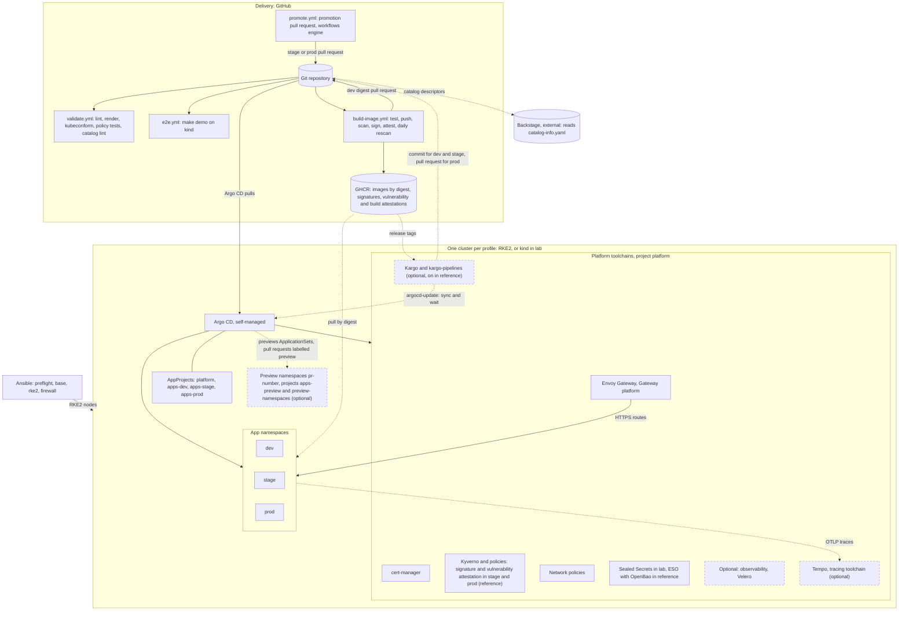

# Architecture overview

This page describes what the platform is, the principles behind it, how its layers fit together and which components run in each profile. It is for engineers who evaluate, operate or extend the platform.

## Purpose and scope

The repository is an opinionated, tested reference for running a small multi-environment Kubernetes platform on RKE2, managed through GitOps with Argo CD. It covers the path from prepared Linux hosts to a running, policed workload:

- node preparation and RKE2 installation with Ansible;
- the cluster platform (Gateway API ingress, certificates, admission policy, network policy, secrets and optional operations components), delivered by Argo CD from this repository;
- a shared Helm library chart for workloads, and one sample service that uses it;
- GitHub Actions workflows that validate every change, build, sign and attest images, and promote them between environments by pull request;
- optional delivery features: promotion orchestration with Kargo, pull request preview environments, and distributed tracing with OpenTelemetry and Tempo;
- Backstage catalog descriptors (`catalog-info.yaml`) for the platform, the sample service and the charts.

The `lab` profile runs the same platform on kind, so it can be evaluated on a workstation with `make demo` (see [quick start](../getting-started/quick-start.md)). The `reference` profile targets one highly available RKE2 cluster (see [production setup](../getting-started/production-setup.md)).

The platform is not:

- A managed service. You operate the nodes, the cluster, upgrades, backups and incident response. The repository provides the code and the runbooks, not an operator.
- A multi-cluster fleet manager. Each profile is one cluster with the namespaces `dev`, `stage` and `prod`. A two-cluster topology (nonprod and prod, with a hub Argo CD) is implemented in the bootstrap chart as hub mode and not tested in CI; see [`bootstrap/README.md`](../../bootstrap/README.md).
- A product installer for virtual machines. It does not install GitLab, PostgreSQL or MariaDB on VMs. In-cluster PostgreSQL is available through the optional CloudNativePG component.
- A substitute for your organisation's own security review. The controls and their limits are documented in [security controls](../security/controls.md) and [known limitations](../security/known-limitations.md). Assess them against your own threat model and compliance requirements before production use.

## Design principles

### Git is the only write path to clusters

Every change to a cluster, whether platform or workload, is a commit to this repository, reviewed in a pull request and applied by Argo CD with automated prune and self-heal. Two steps run from an operator workstation instead: node provisioning with Ansible, and the GitOps bootstrap (`make bootstrap-gitops`), which installs Argo CD and applies the AppProjects and the root Application. Both read their input from the repository. Secret values never enter Git in plaintext. The optional Kargo promotion engine follows the same rule: it commits to the environment files or opens a pull request, and then asks Argo CD to sync; it never applies manifests itself.

Rationale: Git history is the audit trail and `git revert` is the rollback. A manual `kubectl` change is reverted by self-heal, so no configuration exists only inside a cluster.

### One cluster definition feeds Ansible and Argo CD

`clusters/<name>/cluster.yaml` holds the facts about one cluster: name, profile, domain, Git source, namespaces, RKE2 settings and toolchain switches. Ansible reads it through `vars_files`, and the root Application passes it to the `argocd-bootstrap` chart as an extra values file.

Rationale: a namespace, domain or switch has one definition, so what Ansible configures and what Argo CD deploys cannot diverge. The JSON Schema `clusters/schema.json` and `make validate-config` reject a malformed or inconsistent file before anything runs, and `make validate-config STRICT=1 CLUSTER=<name>` also rejects a leftover `CHANGE_ME` or `YOUR_` placeholder before a real install.

### Secure by default, with explicit and reviewed exceptions

The defaults meet the workload contract: non-root, no privilege escalation, all capabilities dropped, `RuntimeDefault` seccomp, read-only root filesystem, resource requests and limits, probes, and an explicit non-`latest` tag or a digest. helm-common renders these defaults. Pod Security Standards labels and Kyverno policies enforce them (Kyverno audits in `dev` and enforces in `stage` and `prod`), and app namespaces start from default-deny network policy. A workload that needs less sets an explicit value or receives a `PolicyException` in the `kyverno` namespace.

Rationale: the safe path is the default path, and every deviation is a reviewed change in Git rather than a silent gap.

### Thin wrapper charts over upstream

Each platform component is a small chart under `helmcharts/system-charts/<name>` that declares the upstream chart as a pinned dependency, commits `Chart.lock` and keeps only local values. Two components are exceptions, because upstream publishes no Helm repository for them: `local-path` vendors the upstream chart in `vendor/local-path-provisioner`, and `system-upgrade-controller` is a local chart built from the upstream release manifests kept in `upstream/`.

Rationale: an upstream fix arrives as a one-line version bump that Renovate proposes, and the local delta stays small enough to review. Outside the two exceptions, no copied template drifts from its source. See [ADR 0007](../adr/0007-wrapper-charts-instead-of-vendoring.md).

### Every claim is tested in CI or marked planned

A capability described in this documentation is covered by a CI job, either static validation in `validate.yml` or the kind end-to-end test in `e2e.yml`, or it is labelled planned or optional.

Rationale: documentation that no test checks drifts from the code. A reader can trust a statement or see that it is not yet backed by a test.

### The same manifests run on kind and on RKE2

Both profiles use the same chart set; toolchain switches differ per profile, so each profile renders the Applications of the toolchains it enables. Beyond the switches they differ only in values: `values-<profile>.yaml` in each wrapper chart, and the settings in the cluster file.

Rationale: the end-to-end test on kind exercises the GitOps structure, policies and charts that run on RKE2, so a green kind run is evidence about the reference cluster. What kind cannot exercise (node OS, RKE2 configuration, etcd, high availability) is listed under the reference profile in [profiles](#profiles).

### Blast radius is bounded per environment

Each environment is a namespace with its own AppProject, quota, limit range and default-deny network policy. App projects cannot create cluster-scoped objects or change the quota, limit range or RBAC of their namespace. An app's own NetworkPolicy can open traffic to its pods but cannot remove the default deny.

Rationale: a faulty or compromised workload, or a wrong commit to one environment's values, stays inside that environment. The mechanism is described in [AppProjects and the tenancy boundary](gitops.md#appprojects-and-the-tenancy-boundary).

## Layers

The platform has four layers, and each layer has one tool that owns it. In the delivery layer, Kargo takes over promotion from the workflows when it is enabled.

| Layer | Owned by | Scope | Changed through |
| --- | --- | --- | --- |
| Nodes | Ansible, RKE2 | OS baseline, firewall, RKE2 servers and agents, etcd snapshot schedule | `clusters/<name>/cluster.yaml`, inventory, `make preflight`, `make bootstrap-k8s` |
| Cluster platform | Argo CD toolchain Applications | Argo CD itself, Gateway, certificates, admission policy, network policy, secrets, optional operations components | Wrapper charts under `helmcharts/system-charts/`, toolchain switches in the cluster file |
| Workloads | App charts built on helm-common | Deployment, Service, HTTPRoute, NetworkPolicy, ServiceAccount, PDB, HPA or KEDA ScaledObject, BackendTrafficPolicy per app | `helmcharts/app-charts/<app>/` and `envs/<env>/<app>/values.yaml` |
| Delivery | GitHub Actions; Kargo when enabled | Validation, image build, signing, attestation, daily rescan, promotion pull requests; with Kargo, promotion commits, the `prod` pull request and verification | Workflows under `.github/workflows/`, the repository variable `PROMOTION_ENGINE`, `toolchains.kargo` in the cluster file |

The diagram shows the target architecture for one profile. Both profiles run one cluster; the two-cluster hub topology is implemented in the bootstrap chart and not tested in CI. Nodes with a dashed border are optional and off by default; Kargo is on in the `reference` profile. Dashed edges are image pulls and the flows of optional or external parts.

With `promote.yml` and with Kargo, the change that reaches a cluster is the same: a commit that sets `image.tag` and `image.digest` in `envs/<env>/<app>/values.yaml`, which Argo CD applies. Only one of the two writes those files at a time: the repository variable `PROMOTION_ENGINE` (`workflows` or `kargo`) selects it, and when it is unset, Kargo writes if a cluster file enables it. The paths are drawn in [GitOps: promotion paths](gitops.md#promotion-paths) and the policy is in [promotion](../operations/promotion.md).

## Profiles

A profile is a set of values, not a different code path. `cluster.profile` in the cluster file selects it, and every wrapper chart applies `values-<profile>.yaml` on top of its `values.yaml`. See [ADR 0005](../adr/0005-lab-and-reference-profiles.md).

| Aspect | `lab` | `reference` |
| --- | --- | --- |
| Cluster | kind cluster created by `make demo`, or one RKE2 node | One RKE2 cluster, highly available |
| Nodes | kind: one control plane and two workers. Single node: one RKE2 server | Three RKE2 servers behind a registration address (VIP or load balancer), plus agents |
| CNI | kind: Calico, installed by `make demo`, which enforces NetworkPolicy. RKE2 node: `rke2.cni` | `rke2.cni`: `canal`, `calico` or `cilium` |
| Storage | `local-path` | Longhorn |
| Secrets backend | Sealed Secrets with offline sealing | External Secrets Operator (ESO) with one shared OpenBao `ClusterSecretStore`, `openbao` |
| TLS issuer (`platform.issuer`) | `selfsigned` | `letsencrypt-staging` or `letsencrypt` |
| Hostnames | `*.localtest.me` resolves to 127.0.0.1; kind maps host ports 80 and 443 to the Gateway | `*.<domain>` in your DNS |
| Argo CD access | `argocd.localtest.me`, initial admin secret | `argocd.<domain>`, OIDC SSO, groups mapped to `role:admin`, `role:deployer` and `role:readonly`, empty `policy.default`, local admin disabled |
| Image signature verification | Disabled, because the demo loads a locally built image | Enforced in `stage` and `prod` |
| Vulnerability attestation gate | Disabled with signature verification | Enforced in `stage` and `prod`: a vulnerability attestation from the build identity, not older than `maxScanAge` (168h), without a CRITICAL finding |
| Promotion engine | `promote.yml` pull requests; the `kargo` toolchain is off | The `kargo` toolchain is on, so Kargo writes the environment files unless the repository variable `PROMOTION_ENGINE` is `workflows`. The `argo-rollouts` and `monitoring` toolchains are on, so every promotion is verified with `success-rate` |
| Pull request previews, tracing | Off by default (`toolchains.previews.enabled`, `toolchains.tracing.enabled`) | Off by default; with previews on, set `hostnameStyle: flat` so that the platform certificate covers their hostnames |
| Admission policy mode | `dev` Audit, `stage` and `prod` Enforce | `dev` Audit, `stage` and `prod` Enforce |
| etcd and node hardening | Not applicable on kind | Scheduled etcd snapshots, optional S3 target, optional CIS profile |
| Observability and backup | Off by default | Optional, switched on per toolchain in `clusters/reference/cluster.yaml` |
| How it is tested | `e2e-kind` on every pull request and nightly, plus all static checks | Static checks render and validate the reference values; Ansible roles run in Molecule; the RKE2 installation is verified by hand with the local VM harness `tests/integration/rke2`; no workflow runs it |

In both profiles the Argo CD UI and the apps are reached through HTTPRoutes attached to the Gateway `platform`, with TLS from the certificate `platform-tls`. Only the domain, the certificate issuer and the address in front of the Gateway differ between the profiles.

## Component map

Versions are not listed here. The [support matrix](../reference/support-matrix.md) is generated from the rendered manifests by `make support-matrix` and is the only place that states them.

| Component (toolchain name) | Purpose | Profile | Default | Chart |
| --- | --- | --- | --- | --- |
| `argo-cd` | GitOps controller; manages itself after the first install | both | on | `helmcharts/system-charts/argo-cd` |
| `gateway-api` | Gateway API CRDs | both | on | `helmcharts/system-charts/gateway-api` |
| `cert-manager` | Certificate controller; issues the Gateway certificate `platform-tls` | both | on | `helmcharts/system-charts/cert-manager` |
| `sealed-secrets` | Decrypts SealedSecrets committed to Git | lab | on | `helmcharts/system-charts/sealed-secrets` |
| `external-secrets` | Syncs Secrets from OpenBao through the shared `ClusterSecretStore` `openbao`, which the `openbao` chart renders | reference | on | `helmcharts/system-charts/external-secrets` |
| `openbao` | Secrets store behind ESO | reference | on | `helmcharts/system-charts/openbao` |
| `kyverno` | Admission controller | both | on | `helmcharts/system-charts/kyverno` |
| `kyverno-policies` | CEL `ValidatingPolicy` and `ImageValidatingPolicy` for the workload contract, image signature verification and the vulnerability attestation gate | both | on; signature and attestation checks in `reference` only | `helmcharts/system-charts/kyverno-policies` |
| `envoy-gateway` | Gateway API implementation, GatewayClass `envoy` | both | on | `helmcharts/system-charts/envoy-gateway` |
| `platform-gateway` | Gateway `platform` in `envoy-gateway-system`, listeners `http` and `https` | both | on | `helmcharts/system-charts/platform-gateway` |
| `misc` | Namespaces `dev`, `stage`, `prod` with Pod Security Standards labels, LimitRange and ResourceQuota; the ClusterIssuers and the root CA | both | on | `helmcharts/system-charts/misc` |
| `network-policies` | `default-deny` and `allow-dns` in `dev`, `stage` and `prod`; baseline policies for platform namespaces | both | on | `helmcharts/system-charts/network-policies` |
| `monitoring` | kube-prometheus-stack; the app Applications enable the app ServiceMonitors while it runs | both | optional, on in `reference` | `helmcharts/system-charts/monitoring` |
| `logging` | Grafana Alloy and Loki | both | optional | `helmcharts/system-charts/logging` |
| `tracing` | Tempo; receives OTLP traces from apps that set `otel.enabled` in helm-common. The `monitoring` datasources link logs and traces both ways, and metric exemplars to traces once Prometheus exemplar storage is enabled | both | optional | `helmcharts/system-charts/tracing` |
| `slo` | SLO recording and alerting rules, generated with Sloth at development time and committed | both | optional | `helmcharts/system-charts/slo` |
| `velero` | Backup and restore with Kopia | both | optional | `helmcharts/system-charts/velero` |
| `seaweedfs` | S3 target for backups in the lab | lab | optional | `helmcharts/system-charts/seaweedfs` |
| `argo-rollouts` | Canary rollouts with the Gateway API plugin, `ClusterAnalysisTemplate` `success-rate`, which also verifies Kargo promotions | both | optional, on in `reference` | `helmcharts/system-charts/argo-rollouts` |
| `kargo` | Promotion orchestration: controller, API and UI at `kargo.<domain>` (wave 4), and the Application `kargo-pipelines` (wave 11) with one Kargo Project, Warehouse and Stages `dev`, `stage`, `prod` per app. Writes `image.tag` and `image.digest` to Git; Argo CD applies them | both | optional, on in `reference` | `helmcharts/system-charts/kargo`, `helmcharts/system-charts/kargo-pipelines` |
| `previews` | Pull request preview environments: two ApplicationSets with the GitHub pull request generator, namespaces `pr-<number>` for pull requests with the `preview` label | both | optional (`toolchains.previews.enabled`) | `argocd-bootstrap/templates/previews/`, `helmcharts/app-charts/preview-namespace` |
| `system-upgrade-controller` | RKE2 upgrade Plans | reference | optional | `helmcharts/system-charts/system-upgrade-controller` |
| `local-path` | Node-local storage | lab | optional | `helmcharts/system-charts/local-path` |
| `longhorn` | Replicated block storage | reference | optional | `helmcharts/system-charts/longhorn` |
| `cloudnative-pg` | PostgreSQL operator for in-cluster data | both | optional | `helmcharts/system-charts/cloudnative-pg` |
| `keda`, `opencost`, `falco`, `trivy-operator` | Event-driven autoscaling, cost reporting, runtime detection, in-cluster scanning | both | available, off by default (`toolchains.<name>.enabled`) | `helmcharts/system-charts/<name>` |
| `hello-api` | Sample Go service and the reference consumer of helm-common | both | on | `helmcharts/app-charts/hello-api` |

A toolchain is switched with `toolchains.<name>.enabled`. Core toolchains default to enabled in `argocd-bootstrap/values.yaml`; optional ones default to disabled and are enabled per cluster in `clusters/<name>/cluster.yaml`. The mechanism is described in [the app of apps](gitops.md#the-app-of-apps).

## Configuration boundaries

Each kind of setting has one home. A value that appears in two places is a defect.

| Setting | Location | Read by |
| --- | --- | --- |
| Cluster facts: name, profile, domain, Git source, namespaces, RKE2 settings, toolchain switches | `clusters/<name>/cluster.yaml` | Ansible, root Application |
| Hosts and SSH access | `ansible/inventories/<lab or reference>/hosts.yml` (gitignored) | Ansible |
| Ansible secrets | `group_vars/all/vault.yml` (gitignored), referenced through `vault_` variables | Ansible |
| Component configuration | `helmcharts/system-charts/<name>/values.yaml` and `values-<profile>.yaml` | Toolchain Application |
| App baseline | `helmcharts/app-charts/<app>/values.yaml` | App Application |
| Image digest and environment deltas | `envs/<env>/<app>/values.yaml` | App Application; written by `build-image.yml` and `promote.yml` pull requests, or by Kargo |
| Promotion engine | Repository variable `PROMOTION_ENGINE` in GitHub: `workflows` or `kargo`; unset, `kargo` when a cluster file enables Kargo, else `workflows` (`hack/promotion-engine.sh`) | `build-image.yml`, `promote.yml` |
| Kargo pipeline tuning: auto-promotion, pull request stages, verification | `toolchains.kargo.pipelines.values` in `clusters/<name>/cluster.yaml` | Application `kargo-pipelines` |
| Preview settings and preview deltas | `previews:` in `argocd-bootstrap/values.yaml`, `toolchains.previews.values` in the cluster file; `envs/preview/<app>/values.yaml` | Root Application, which renders the preview ApplicationSets; preview app Applications |
| Accepted vulnerability findings | `toolchains.kyverno-policies.values.imageVerification.vulnerabilities.ignoreVulnerabilityIDs` in the cluster file | `kyverno-policies` toolchain |
| Backstage catalog entities | `catalog-info.yaml` | A Backstage instance outside the cluster |
| Runtime secrets | SealedSecret in Git (`lab`) or an ExternalSecret that references OpenBao (`reference`); plaintext never enters Git | Sealed Secrets controller or ESO |

The keys of the cluster file are documented in [configuration](../reference/configuration.md), and secret handling in [secrets handling](../security/secrets-handling.md).

## Non-goals and boundaries

Deliberately not included:

- Tools without a stated need. Each component answers a specific requirement in the platform; there is no service mesh, log search cluster or message broker.
- Tenancy finer than the environment. The boundary is the environment namespace and its AppProject. A tenant chart for team namespaces (`tenants/chart`, one tenant per `tenants/<name>.yaml`) is available and off by default (`toolchains.tenants.enabled`).
- Hands-free production. Nothing auto-merges. Every change to `prod` is a reviewed pull request, with either promotion engine, and `prod` syncs inside a sync window. With `promote.yml`, every change to `stage` is a reviewed pull request too; Kargo commits `dev` and `stage` promotions directly unless `pullRequest: true` is set for those stages.
- Infrastructure provisioning. The platform starts from reachable Linux hosts. An optional OpenTofu example for one reference target is available in `infra/hetzner`; it is validated and tested offline in CI and never applied there.

Responsibilities:

| Concern | Platform enforces | App team owns | Operator owns |
| --- | --- | --- | --- |
| Workload security | Admission policy, Pod Security Standards labels, image signature and vulnerability attestation verification in `reference` | Values that meet the workload contract, justified exceptions, fixed images for new CRITICAL findings | Review of `PolicyException` objects and of accepted vulnerability IDs |
| Promotion | Both engines write only `image.tag` and `image.digest`; `prod` changes through a pull request in both | The decision to promote; with Kargo, the release version in `sample-services/<app>/VERSION` | The choice of engine (`PROMOTION_ENGINE`), the Kargo Git credential and its scope |
| Network | Default-deny ingress and egress and DNS in app namespaces, baseline policies in platform namespaces | Its app's NetworkPolicy, rendered by helm-common by default | Firewall and network in front of the nodes |
| Exposure and TLS | Gateway `platform`, certificate `platform-tls` | The route settings of its app | DNS records and the load balancer in front of the Gateway |
| Secrets | Controllers, `ClusterSecretStore`, no plaintext in Git | Which secrets the app consumes | Secret values, key escrow and rotation |
| Lifecycle | Pinned versions, Renovate pull requests, CI gates | App upgrades and image builds | Node OS patching, RKE2 and Argo CD upgrades, backups and restore tests |

The runbooks for the operator column are under `docs/operations/`, for example [backup and restore](../operations/backup-and-restore.md) and [upgrade RKE2](../operations/upgrade-rke2.md).

## Related decisions

- [ADR 0001: RKE2 as the only Kubernetes provisioner](../adr/0001-rke2-only.md)
- [ADR 0002: Argo CD app of apps with AppProjects](../adr/0002-argocd-app-of-apps-with-appprojects.md)
- [ADR 0003: Gateway API with Envoy Gateway for ingress](../adr/0003-gateway-api-with-envoy-gateway.md)
- [ADR 0004: Kyverno CEL policies for admission control](../adr/0004-kyverno-cel-policies.md)
- [ADR 0005: Lab and reference topology profiles](../adr/0005-lab-and-reference-profiles.md)
- [ADR 0006: Sealed Secrets in lab, External Secrets Operator with OpenBao in reference](../adr/0006-sealed-secrets-and-eso-with-openbao.md)
- [ADR 0007: Wrapper charts instead of vendoring](../adr/0007-wrapper-charts-instead-of-vendoring.md)
- [ADR 0008: Keyless image signing](../adr/0008-keyless-image-signing.md)
- [ADR 0009: GitHub Actions as reference CI, Jenkins optional](../adr/0009-github-actions-reference-ci-jenkins-optional.md)
- [ADR 0010: Go sample service](../adr/0010-go-sample-service.md)
- [ADR 0011: Promotion by pull request and digest](../adr/0011-promotion-by-pull-request-and-digest.md)
- [ADR 0012: Kargo as optional promotion orchestration](../adr/0012-kargo-promotion.md)
