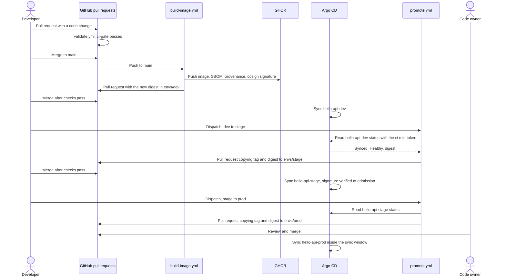

# Promotion and deployment policy

This page states the deployment policy and the procedure that moves an image from `dev` to `stage` to `prod`. It is for developers who ship a change and for the reviewers who approve production.

## Two promotion paths, one writer

Two engines can promote: the workflows `build-image.yml` and `promote.yml`, which open pull requests, and Kargo, which is optional and on in the `reference` profile ([ADR 0012](../adr/0012-kargo-promotion.md)). Both change the same two keys, `image.tag` and `image.digest`, in the same files, `envs/<env>/<app>/values.yaml`, and Argo CD applies the result in both cases. Two writers on one file would overwrite each other's promotions, so only one engine writes per repository:

| Engine | Writes `envs/dev` | Writes `envs/stage` | Writes `envs/prod` |
| --- | --- | --- | --- |
| workflows | `build-image.yml`, pull request per build on `main` | `promote.yml`, pull request | `promote.yml`, pull request, code owner review |
| kargo | Kargo, commit per new release tag (automatic) | Kargo, commit on manual promotion | Kargo, pull request on manual promotion, code owner review |

- The repository variable `PROMOTION_ENGINE` sets the engine: `workflows` or `kargo`. When it is unset, the engine is `kargo` if any `clusters/*/cluster.yaml` enables `toolchains.kargo` with its pipelines, and `workflows` otherwise. Both workflows decide with the same script, `hack/promotion-engine.sh`, and print the result and its reason as a notice. Any other value fails them.
- With the kargo engine, the `bump-dev` job of `build-image.yml` is skipped and `promote.yml` stops with an error, so the workflows cannot write next to Kargo. The `reference` cluster file enables Kargo, so this is the default of a repository that keeps that file. Set `PROMOTION_ENGINE=workflows` to keep the pull request flow there, and disable the Kargo pipelines in that case.
- When Kargo takes over, close open bump and promotion pull requests.
- Switching back: disable the Kargo pipelines first (`toolchains.kargo.enabled: false` or `toolchains.kargo.pipelines.enabled: false`). With no cluster file enabling Kargo, the workflows write again; an explicit `PROMOTION_ENGINE=kargo` must be deleted as well. Setting `PROMOTION_ENGINE=workflows` while the pipelines still run would leave Kargo and the workflows writing at the same time.
- A reviewer who sees a promotion pull request from the engine that is not selected closes it.

The policy below applies to both paths, with the differences that rules 3, 4 and 10 state. The rest of this page describes the workflows path; the Kargo procedure is in [promote with Kargo](../how-to/promote-with-kargo.md).

## Deployment policy

1. Images are referenced by digest. Each environment file `envs/<env>/<app>/values.yaml` holds only `image.tag` and `image.digest`. When `image.digest` is set, helm-common renders `repository@digest` and the tag is informational.
2. No `latest`. Kyverno rejects a pod whose image has the `latest` tag or no tag and no digest; it audits in `dev` and enforces in `stage` and `prod`. See [controls](../security/controls.md).
3. Every release is a pull request on the workflows path. The flow is `dev`, then `stage`, then `prod`, and each step copies the digest that runs in the previous environment. With Kargo, `prod` is a pull request; `dev` and `stage` are direct commits unless `pullRequest: true` is set for those stages, and a stage accepts only a release verified in the stage before it.
4. Promotion is verified. When the repository variable `ARGOCD_SERVER` and the secret `ARGOCD_CI_TOKEN_<ENV>` of the source environment are set, `promote.yml` checks through the Argo CD API that the source Application `<app>-<env>` is Synced and Healthy and runs that digest, before it opens the pull request. The token belongs to the read-only AppProject role `ci` of the source project. Without that configuration the check is skipped, the workflow logs a warning, and the pull request says that the reviewer must check the source environment in Argo CD. The workflow only reads status; it never syncs. Kargo instead asks Argo CD to sync the target Application, waits until it runs the new commit, and then runs the `success-rate` analysis when the `argo-rollouts` and `monitoring` toolchains are enabled, as in the `reference` profile.
5. A promotion pull request changes only `image.tag` and `image.digest`. Sizing and other per-environment settings change through a normal pull request to the chart.
6. Production needs an owner. CODEOWNERS covers `envs/prod/`, so a prod promotion needs an approving review from an owner.
7. Production has a sync window. In the `reference` profile, the `apps-prod` AppProject allows syncs only inside a window; a merged change outside it waits for the window. The lab has no window.
8. No imperative changes. No `kubectl set image`, `kubectl edit`, `kubectl apply` or `helm upgrade` against the app namespaces, no Argo CD parameter overrides, and no manual sync to push a release. Argo CD self-heal reverts drift.
9. Nothing auto-merges: not the build pull request, not the promotion pull requests, not Renovate.
10. Workflow pull requests are checked like any other. A pull request opened with the default `GITHUB_TOKEN` does not trigger other workflows, so `build-image.yml` and `promote.yml` open their pull requests with a GitHub App token (`actions/create-github-app-token`) when the repository variable `GITOPS_APP_ID` and the secret `GITOPS_APP_PRIVATE_KEY` exist. Without them, the workflow falls back to `GITHUB_TOKEN` and dispatches `validate.yml` on the pull request branch, so `ci-gate` reports on the head commit. Creating and installing the GitHub App is a one-time action by the repository owner. Kargo's direct `dev` and `stage` commits do not pass through a pull request, so `ci-gate` does not check them before they land; its `prod` pull request follows the same branch rules and code owner review as any other.
11. Signed images only. In the `reference` profile, Kyverno admits images in `stage` and `prod` only when they carry a cosign signature from this repository's `build-image.yml` on `main`, and a vulnerability attestation from the same identity that is younger than `maxScanAge` and has no CRITICAL finding. This applies to both promotion paths. The lab disables this check because the kind demo loads a locally built image. See [supply chain](../security/supply-chain.md).
12. Every running digest traces back to a commit, a workflow run and an attestation (see [trace a running image to its source](#trace-a-running-image-to-its-source)).

## Flow



Argo CD watches the chart and environment paths through `manifest-generate-paths`, so a merged values change reaches the cluster without a hard refresh.

## Promote a release

### Purpose

Move the digest that runs in one environment to the next environment.

### When to use

The change runs in the source environment and passed the checks you require there (manual tests, dashboards, the time you wait in stage).

### Preconditions

- The source Application `<app>-<env>` is Synced and Healthy on the digest you want to promote:

  ```bash
  kubectl -n argocd get application <app>-<env>
  ```

- No other promotion pull request for the same app and target environment is open.
- For prod in the `reference` profile: you know the sync window (`argocd proj windows list apps-prod --grpc-web`) and an owner from CODEOWNERS is available to review.

### Steps

1. Dispatch the promotion workflow with the app and the source environment (`dev` promotes to `stage`, `stage` promotes to `prod`):

   ```bash
   gh workflow run promote.yml --repo YOUR_ORG/sk-k8s-devops-bootstrap -f app=hello-api -f from=dev
   gh run watch --repo YOUR_ORG/sk-k8s-devops-bootstrap
   ```

2. When the Argo CD variable and token are configured, the workflow checks the source Application with the token of the `ci` role. If it is not Synced and Healthy on the digest, the run fails and opens nothing. Without that configuration the pull request states that the health was not verified, and the reviewer checks it in Argo CD. When the target already runs the same digest, the run ends without a pull request.

3. Review the promotion pull request. The diff touches only `image.tag` and `image.digest` in `envs/<target>/<app>/values.yaml`. Compare the digest with the one running in the source environment.

4. Merge after `ci-gate` passes. For `envs/prod/`, an owner approves first.

5. Argo CD syncs `<app>-<target>`. In prod, the sync happens when the window is open.

### Verification

```bash
kubectl -n argocd get application <app>-<target>
kubectl -n <target> get pods -l app.kubernetes.io/name=<app> \
  -o jsonpath='{range .items[*]}{.status.containerStatuses[0].imageID}{"\n"}{end}'
```

The Application is Synced and Healthy, and every pod runs the promoted digest.

### Rollback or abort

- Before the merge: close the pull request.
- After the merge: revert the promotion pull request with a Git revert in a new pull request (the GitHub "Revert" button, or `git revert <merge-commit>` on a branch). The revert restores the previous `image.tag` and `image.digest`, and it follows the same checks and, for prod, the same review. Do not roll back with a manual change in the cluster.
- Outside the prod window, the revert waits like any other change. If the window allows a manual sync (`manualSync: true`), an admin may sync the reverted Git state in an emergency; this triggers a sync of what is in Git, it does not change the desired state.

## Trace a running image to its source

Each step answers one question: which digest runs, which commit put it there, which build produced it, and whether the signature is valid. You need `gh` authenticated to GitHub and a registry login for GHCR.

1. The digest that runs:

   ```bash
   kubectl -n <env> get pods -l app.kubernetes.io/name=<app> \
     -o jsonpath='{.items[0].status.containerStatuses[0].imageID}'
   ```

2. The commit that put the digest into the environment:

   ```bash
   git log --oneline -S '<digest>' -- envs/<env>/<app>/values.yaml
   ```

3. The source commit and the workflow run that built it, from the build provenance attestation:

   ```bash
   gh attestation verify oci://ghcr.io/your-org/<app>@sha256:<digest> \
     --repo YOUR_ORG/sk-k8s-devops-bootstrap \
     --signer-workflow YOUR_ORG/sk-k8s-devops-bootstrap/.github/workflows/build-image.yml \
     --format json \
     | jq '.[0].verificationResult.signature.certificate | {sourceRepositoryDigest, sourceRepositoryRef, runInvocationURI}'
   ```

4. The cosign signature, against the identity the admission policy uses:

   ```bash
   cosign verify ghcr.io/your-org/<app>@sha256:<digest> \
     --certificate-oidc-issuer https://token.actions.githubusercontent.com \
     --certificate-identity-regexp '^https://github\.com/[^/]+/sk-k8s-devops-bootstrap/\.github/workflows/build-image\.yml@refs/heads/main$'
   ```

## Optional and planned

- Canary releases are optional. With the `argo-rollouts` toolchain enabled, `rollout.enabled` in an app's values renders an Argo Rollouts `Rollout` that shifts traffic through the HTTPRoute and runs the `ClusterAnalysisTemplate` `success-rate`. A failed analysis aborts and rolls back the canary; an analysis without traffic is Inconclusive and pauses the rollout. The toolchain is off by default.
- On the workflows path, gating `promote.yml` on the result of a canary analysis is planned, not implemented. With Kargo, a stage accepts only Freight that was verified in the stage before it, with the `success-rate` analysis when verification is enabled.
- Promotion orchestration with Kargo is optional ([ADR 0012](../adr/0012-kargo-promotion.md), [Promote with Kargo](../how-to/promote-with-kargo.md)). It writes the same two keys and verifies each promotion with the `success-rate` analysis when the `argo-rollouts` and `monitoring` toolchains are enabled, as in the `reference` profile. The flow on this page applies wherever the workflows are the engine; how the two paths coexist is in [two promotion paths, one writer](#two-promotion-paths-one-writer).

## References

- Decision record: [ADR 0011](../adr/0011-promotion-by-pull-request-and-digest.md) and [ADR 0008](../adr/0008-keyless-image-signing.md)
- CI and the build workflow: [CI/CD](../architecture/ci-cd.md)
- Argo CD sync windows: <https://argo-cd.readthedocs.io/en/stable/user-guide/sync_windows/>
- Argo CD automated sync and self-heal: <https://argo-cd.readthedocs.io/en/stable/user-guide/auto_sync/>
- GitHub CLI `gh workflow run` and `gh attestation verify`: <https://cli.github.com/manual/gh_workflow_run> and <https://cli.github.com/manual/gh_attestation_verify>
- cosign verify: <https://docs.sigstore.dev/cosign/verifying/verify/>
- GitHub CODEOWNERS: <https://docs.github.com/en/repositories/managing-your-repositorys-settings-and-features/customizing-your-repository/about-code-owners>
- Argo Rollouts analysis: <https://argo-rollouts.readthedocs.io/en/stable/features/analysis/>
