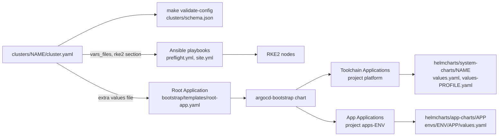

# Configuration reference

This page describes the cluster definition file `clusters/<name>/cluster.yaml`: every key, who reads it, and how it is validated. It is for operators who set up a cluster and for contributors who add a key.

## One file per cluster

Each cluster has one non-secret file at `clusters/<name>/cluster.yaml`, where `<name>` equals `cluster.name`. The repository ships two: `clusters/lab/cluster.yaml` and `clusters/reference/cluster.yaml`. Secrets never go into this file; see [secrets handling](../security/secrets-handling.md).

Two consumers read the same file:

- Ansible loads it through `vars_files` in the playbooks. The `rke2` section drives the `preflight`, `firewall` and `rke2` roles.
- Argo CD reads it through the root Application, which passes it to the `argocd-bootstrap` chart as an extra values file after `argocd-bootstrap/values.yaml`. A key in the cluster file therefore overrides the chart default. Only the git overrides given at bootstrap (`REPO_URL`, `TARGET_REVISION`) take precedence over it, through the root Application's `valuesObject.git`. The toolchain and app templates read `.Values.cluster`, `.Values.git`, `.Values.namespaces`, `.Values.platform` and `.Values.toolchains`, and pass what a component needs into the Application they render.

Helm ignores the `rke2` section: no template reads it.



Each toolchain Application uses the wrapper chart's `values.yaml` plus `values-<profile>.yaml`, where `<profile>` is `cluster.profile`. Each app Application uses the app chart's `values.yaml` plus `envs/<env>/<app>/values.yaml`, and passes `global.environment`, `global.domain`, `global.cluster` and `global.profile`, so the chart can derive its host name `<app>.<env>.<domain>` and the environment file stays independent of the cluster. [GitOps structure](../architecture/gitops.md) describes both layers.

## Keys

The "Used by" column names the consumer: Ansible, argocd-bootstrap, or both. Defaults and examples come from the `lab` file unless stated.

### `cluster`

| Key | Type | Default or example | Used by | Description |
| --- | --- | --- | --- | --- |
| `cluster.name` | string, DNS label | `lab` | both | Cluster name. Must equal the directory name under `clusters/`. |
| `cluster.profile` | `lab` or `reference` | `lab` | both | Selects `values-<profile>.yaml` in every wrapper chart and the profile behaviour described [below](#lab-and-reference). |
| `cluster.domain` | string, DNS name | `localtest.me` | argocd-bootstrap | Base domain. Argo CD is served at `argocd.<domain>` and apps at `<app>.<env>.<domain>`. The names on the Gateway certificate depend on the TLS mode, see [TLS keys](#tls-keys). |
| `cluster.kubernetesMinor` | string, `1.NN` | see the [support matrix](support-matrix.md) | argocd-bootstrap, render tooling | Kubernetes minor version the manifests are rendered for and validated against by `make render` and `make kubeconform`. |
| `cluster.environments` | list of `dev`, `stage`, `prod` | `[dev, stage, prod]` | argocd-bootstrap | Optional. Application environments hosted by this cluster. App projects and app Applications render only for these. |
| `cluster.destination.name` | string, DNS label | not set | argocd-bootstrap | Optional, hub mode only. The name under which a remote cluster is registered in the hub Argo CD (`argocd cluster add --name`). Omit it for the cluster Argo CD runs in. See [`bootstrap/README.md`](../../bootstrap/README.md). |

### `git`

| Key | Type | Default or example | Used by | Description |
| --- | --- | --- | --- | --- |
| `git.repoURL` | string, HTTPS or SSH URL | `https://github.com/YOUR_ORG/sk-k8s-devops-bootstrap.git` | argocd-bootstrap | Repository Argo CD reads: your fork. `make bootstrap-gitops` uses it for the root Application unless `REPO_URL` overrides it. The `url` of a repository Secret must equal it character for character, so use one URL form everywhere. The kind demo points Argo CD at an in-cluster Git server seeded from your local `HEAD` instead. |
| `git.targetRevision` | string | `main` | argocd-bootstrap | Branch, tag or commit SHA Argo CD tracks. |

### `rke2`

Read by Ansible only. Required when `cluster.profile` is `reference`. In the `lab` profile it is used only when the lab runs on a single RKE2 node; kind ignores it.

| Key | Type | Default or example | Used by | Description |
| --- | --- | --- | --- | --- |
| `rke2.version` | string | `v<major>.<minor>.<patch>+rke2r<n>` | Ansible | Exact RKE2 release to install. `make preflight` rejects `CHANGE_ME`. |
| `rke2.channel` | string | `stable` | Ansible | RKE2 release channel. `version` pins the release that is installed. |
| `rke2.cni` | `canal`, `calico` or `cilium` | `canal` | Ansible | CNI plugin. All three enforce NetworkPolicy. The `firewall` role opens the ports of the selected CNI. |
| `rke2.podCidr` | IPv4 CIDR | `10.42.0.0/16` | Ansible | Pod network. Must not overlap the node or service networks. |
| `rke2.serviceCidr` | IPv4 CIDR | `10.43.0.0/16` | Ansible | Service network. |
| `rke2.registrationAddress` | string | `""` | Ansible | Fixed registration address for HA: a virtual IP or load balancer in front of the servers. Empty for a single server. |
| `rke2.cisProfile` | boolean | `false` | Ansible | Applies the RKE2 CIS profile and its host preparation. |
| `rke2.etcdSnapshots.schedule` | cron expression, five fields | `"0 */6 * * *"` | Ansible | etcd snapshot schedule. |
| `rke2.etcdSnapshots.retention` | integer | `10` | Ansible | Number of snapshots to keep. |
| `rke2.etcdSnapshots.s3.enabled` | boolean | `false` | Ansible | Copies snapshots to S3. When true, `endpoint` and `bucket` are required. |
| `rke2.etcdSnapshots.s3.endpoint` | string | `""` | Ansible | S3 endpoint host. |
| `rke2.etcdSnapshots.s3.bucket` | string | `""` | Ansible | Bucket name. |
| `rke2.etcdSnapshots.s3.folder` | string | `""` | Ansible | Prefix inside the bucket. |
| `rke2.etcdSnapshots.s3.region` | string | `""` | Ansible | Bucket region. |

The S3 credentials are secrets and live in the Ansible vault, not in this file. See [backup and restore](../operations/backup-and-restore.md) for restores.

### `namespaces`

| Key | Type | Default or example | Used by | Description |
| --- | --- | --- | --- | --- |
| `namespaces.argocd` | string, DNS label | `argocd` | argocd-bootstrap | Namespace of Argo CD and of every Application object. |
| `namespaces.dev` | string, DNS label | `dev` | argocd-bootstrap | Application namespace for `dev`. |
| `namespaces.stage` | string, DNS label | `stage` | argocd-bootstrap | Application namespace for `stage`. |
| `namespaces.prod` | string, DNS label | `prod` | argocd-bootstrap | Application namespace for `prod`. |
| `namespaces.gateway` | string, DNS label | `envoy-gateway-system` | argocd-bootstrap | Namespace of Envoy Gateway and the Gateway `platform`. |
| `namespaces.certManager` | string, DNS label | `cert-manager` | argocd-bootstrap | Namespace of cert-manager. |
| `namespaces.kyverno` | string, DNS label | `kyverno` | argocd-bootstrap | Namespace of Kyverno and of every `PolicyException`. |
| `namespaces.monitoring` | string, DNS label | `monitoring` | argocd-bootstrap | Namespace of the monitoring stack. |

The `argocd`, `dev`, `stage` and `prod` namespaces must be distinct. Components that need another namespace add a key here. Changing a value changes every rendered manifest that refers to it.

### `platform`

| Key | Type | Default or example | Used by | Description |
| --- | --- | --- | --- | --- |
| `platform.certManagerEmail` | string, email | `platform@example.com` | argocd-bootstrap | Contact address of the ACME account. |
| `platform.issuer` | `selfsigned`, `letsencrypt-staging` or `letsencrypt` | `selfsigned` | argocd-bootstrap | ClusterIssuer of the Gateway certificate `platform-tls`; the ClusterIssuer names equal these values. `selfsigned` is CA-backed, so Secret `platform-tls` carries `ca.crt`. |
| `platform.imageRegistry` | string | `ghcr.io/your-org` | argocd-bootstrap | Registry and namespace of the owned images. |
| `platform.groups.admins` | string | `platform-admins` | argocd-bootstrap | Identity provider group mapped to the Argo CD role `role:admin`. |
| `platform.groups.deployers` | string | `deployers` | argocd-bootstrap | Identity provider group mapped to `role:deployer`: get, sync, actions and logs in the app projects. |
| `platform.groups.viewers` | string | `viewers` | argocd-bootstrap | Identity provider group mapped to `role:readonly`. |

The groups map to Argo CD roles in `policy.csv`. `policy.default` is empty, so a user in none of the groups gets no access. See [Argo CD SSO](../security/argocd-sso.md).

#### TLS keys

These keys belong to the TLS design of the Gateway ([ADR 0003](../adr/0003-gateway-api-with-envoy-gateway.md#tls-certificate)). They decide which names the certificate `platform-tls` covers when `platform.issuer` is an ACME issuer (`letsencrypt-staging` or `letsencrypt`).

| Key | Type | Default or example | Used by | Description |
| --- | --- | --- | --- | --- |
| `platform.acme.solver` | `http01` or `dns01` | `http01` | argocd-bootstrap | ACME challenge type. `http01`: no wildcard; the certificate lists exactly `platform.gateway.hostnames`, issued through the cert-manager `gatewayHTTPRoute` solver on the listener `http` of Gateway `platform`. `dns01`: the certificate covers `<domain>`, `*.<domain>` and `*.<env>.<domain>` for every environment. |
| `platform.acme.dns01` | object | not set | argocd-bootstrap | Required for `dns01`. The DNS provider block of the ACME solver. Placeholders only in Git: credentials are referenced by Secret name and key, never inline. |
| `platform.gateway.hostnames[]` | list of DNS names | not set | argocd-bootstrap | Required for `http01`. Every host name the Gateway serves, including `argocd.<domain>`, each `<app>.<env>.<domain>`, `grafana.<domain>` when the `monitoring` toolchain is on and `kargo.<domain>` when the `kargo` toolchain is on; `make validate-config` checks that these are listed. The render fails when the list is empty, contains a wildcard or names a host outside `cluster.domain`. |
| `platform.acme.server` | string, empty or an `https://` URL | `""` | argocd-bootstrap | Test only. Replaces the ACME directory URL of the `letsencrypt-staging` ClusterIssuer. The `letsencrypt` issuer is never redirected. |
| `platform.acme.caBundle` | string, base64 | `""` | argocd-bootstrap | Test only. Base64-encoded PEM CA bundle that signs the TLS certificate of `platform.acme.server`. Rendered as `caBundle` of the `letsencrypt-staging` ClusterIssuer only. |

`platform.acme.server` and `platform.acme.caBundle` exist for the [ACME integration test](../../tests/integration/acme/README.md), which points `letsencrypt-staging` at a local Pebble ACME server. Both default to empty and must stay empty on real clusters. The `misc` Application passes them to the `misc` chart as `issuers.acme.server` and `issuers.acme.caBundle`; with an empty `server`, `letsencrypt-staging` uses the Let's Encrypt staging directory from the chart values.

With `selfsigned`, the certificate covers `<domain>`, `*.<domain>` and `*.<env>.<domain>` for every environment, as in `dns01` mode, and these keys are not needed. A wildcard covers one label only, so `*.<domain>` alone does not cover `<app>.<env>.<domain>`. [Production setup](../getting-started/production-setup.md#11-issue-the-certificate) shows an example of each mode.

### `toolchains`

| Key | Type | Default or example | Used by | Description |
| --- | --- | --- | --- | --- |
| `toolchains.<name>.enabled` | boolean | `{}` (no overrides) | argocd-bootstrap | Switches the toolchain Application rendered by `argocd-bootstrap/templates/toolchains/<name>.yaml` on or off. `toolchains.cluster-secrets.enabled` switches the Application `cluster-secrets`, which applies `clusters/<name>/secrets/`. |
| `toolchains.<name>.values` | object | not set | argocd-bootstrap | Optional. Cluster-specific values for that toolchain's chart, passed as `helm.valuesObject`, which Argo CD applies over the wrapper chart's value files. Never secrets. |
| `toolchains.kargo.pipelines.enabled` | boolean | `true` | argocd-bootstrap | With `toolchains.kargo.enabled`, renders the Kargo Projects, Warehouses and Stages for the app inventory (chart `kargo-pipelines`). `false` installs Kargo without pipelines; Kargo is then not the promotion engine. |
| `toolchains.kargo.pipelines.values` | object | not set | argocd-bootstrap | Values of `kargo-pipelines`, such as `projectPrefix` and `warehouse.*`. The keys the bootstrap injects (Git, Argo CD, registry, groups, apps) are not set here. |
| `toolchains.previews.enabled`, `toolchains.previews.values` | boolean, object | `false`, not set | argocd-bootstrap | Pull request preview environments ([preview environments](../how-to/preview-environments.md)). |
| `toolchains.tenants.enabled` | boolean | `false` | argocd-bootstrap | Tenant onboarding from `tenants/<name>.yaml` through an ApplicationSet. |

Core toolchains default to enabled and optional ones to disabled, both in `argocd-bootstrap/values.yaml`. The cluster file sets only the deltas for that cluster, for example:

```yaml
toolchains:
  monitoring: {enabled: true}
  velero: {enabled: true}
```

Every key must name a switch that a bootstrap template reads (`dig "<name>" "enabled"`): a toolchain template, `cluster-secrets`, `previews` or `tenants`. `make validate-config` fails on any other name.

## Lab and reference

The two shipped files differ in these values:

| Key | `lab` | `reference` |
| --- | --- | --- |
| `cluster.profile` | `lab` | `reference` |
| `cluster.domain` | `localtest.me` | Your domain (an `example.com` placeholder until you set it) |
| `rke2` section | Optional; used only on a single RKE2 node | Required |
| `rke2.registrationAddress` | `""` (one server) | Virtual IP or load balancer address |
| `rke2.cisProfile` | `false` | `true` |
| `rke2.etcdSnapshots.s3.enabled` | `false` | `true` |
| `platform.issuer` | `selfsigned` | `letsencrypt-staging`, then `letsencrypt` |
| `toolchains` | `{}`: the core toolchains only | `sealed-secrets` off; `external-secrets`, `openbao`, `longhorn`, `monitoring`, `argo-rollouts` and `kargo` on |

`cluster.profile` also selects behaviour that lives in the wrapper charts' `values-<profile>.yaml` files, not in the cluster file:

| Behaviour | `lab` | `reference` |
| --- | --- | --- |
| Cluster | kind with Calico through `make demo` (one control plane, two workers), or a single node | One RKE2 HA cluster: three servers, one or more agents |
| Secrets | Sealed Secrets with offline sealing | External Secrets Operator with OpenBao |
| Argo CD login | Initial admin secret | OIDC single sign-on, local admin disabled |
| Image signature verification | Off | Enforced in `stage` and `prod` |
| Vulnerability attestation | Not checked | Required in `stage` and `prod`: a Trivy attestation younger than seven days without CRITICAL findings |

The promotion engine is set per repository, not per profile: Kargo whenever a cluster file enables it, as the shipped `reference` file does, unless the repository variable `PROMOTION_ENGINE` is `workflows` ([promotion paths](../architecture/gitops.md#promotion-paths)).

[ADR 0005](../adr/0005-lab-and-reference-profiles.md) records the reasoning.

## Minimal example for `lab`

A complete file that passes the schema, for kind:

```yaml
# yaml-language-server: $schema=../schema.json
cluster:
  name: lab
  profile: lab
  domain: localtest.me
  kubernetesMinor: "1.36" # match the support matrix
git:
  repoURL: https://github.com/YOUR_ORG/sk-k8s-devops-bootstrap.git
  targetRevision: main
namespaces:
  argocd: argocd
  dev: dev
  stage: stage
  prod: prod
  gateway: envoy-gateway-system
  certManager: cert-manager
  kyverno: kyverno
  monitoring: monitoring
platform:
  certManagerEmail: platform@example.com
  issuer: selfsigned
  imageRegistry: ghcr.io/your-org
  groups:
    admins: platform-admins
    deployers: deployers
    viewers: viewers
toolchains: {}
```

Add the `rke2` section from `clusters/lab/cluster.yaml` when the lab runs on a single RKE2 node instead of kind.

## Validation

- Schema: `clusters/schema.json` is a JSON Schema for the file: required keys, types, enumerations and formats. The first line `# yaml-language-server: $schema=../schema.json` lets editors validate while you type.
- `make validate-config` runs `hack/validate-config.sh`. It validates every `clusters/*/cluster.yaml` against the schema, then runs the checks a schema cannot express: `cluster.name` equals the directory name, the `argocd`, `dev`, `stage` and `prod` namespaces are distinct, and every `toolchains` key matches a template.
- Placeholders: the script reports `CHANGE_ME`, `YOUR_` and `<UPPER_CASE>` values as warnings. With `STRICT=1` it fails on them, and on an `example.com` domain in a `reference` cluster. Run `make validate-config STRICT=1 CLUSTER=<name>` before a real install; without `CLUSTER` it also checks the shipped `lab` file and `tenants/team-a.yaml`, which keep their placeholders. `make preflight` independently rejects `rke2.version: CHANGE_ME`.
- CI: the job `config` in `.github/workflows/validate.yml` runs the same script on every pull request.
