# Supply chain

This page follows an image from commit to running pod: how it is built, scanned, signed and attested, how it is deployed by digest, how its vulnerability scan is kept current, and what admission checks before it runs. It also shows how to verify an image by hand and states what the supply-chain controls do not cover. It is for reviewers and for anyone who consumes the published images.

## From commit to running pod

```mermaid
flowchart LR
  COMMIT["Commit on main"] --> BUILD["build-image.yml: test, buildx with SBOM and provenance"]
  BUILD --> PUSH["Push to GHCR"]
  PUSH --> SCAN["Trivy scan of the pushed digest"]
  SCAN -->|"no fixable CRITICAL or HIGH"| SIGN["cosign keyless signature"]
  SIGN --> VULN["cosign vulnerability attestation: Trivy report"]
  VULN --> ATT["GitHub artifact attestations"]
  ATT --> DEVPR["Pull request: digest into envs/dev"]
  DEVPR --> PROMO["promote.yml: pull request to stage, then prod"]
  PROMO --> ADM["Admission: Kyverno checks tag, registry, signature and vulnerability attestation"]
  ADM --> POD["Pod runs the same digest"]
  RESCAN["Daily rescan of the digests in envs/"] -->|"newer vulnerability attestation"| ADM
```



### Pinned inputs

The Dockerfile of `sample-services/hello-api` references its base images by digest, including the distroless static `nonroot` runtime image, which runs as UID 65532. A tag can be moved by whoever controls it; a digest names exactly one image. Go module versions are fixed in `go.mod` and their checksums in `go.sum`. Renovate proposes base image updates as pull requests.

### Build with SBOM and provenance

`.github/workflows/build-image.yml` runs the service tests, then, on `main`, builds with `docker buildx build --sbom=true --provenance=mode=max` and pushes the image. BuildKit attaches two attestations to the image index: an SPDX SBOM and a SLSA provenance document. `mode=max` records the full build definition, including build arguments. Secrets must therefore never go into build arguments; a build that needs one uses a BuildKit secret mount.

### Scan gate

On `main`, Trivy scans the pushed digest. A CRITICAL or HIGH vulnerability with an available fix fails the job before the signing step, so the image stays in GHCR unsigned and without attestations, and no dev bump pull request is opened. It never reaches an environment through the bump, and `stage` and `prod` admission in the `reference` profile rejects it because it is unsigned. On pull requests the image is built for the runner platform, loaded locally and scanned; nothing is pushed. Vulnerabilities without a fix do not block; they are resolved by a rebuild once a fixed base image or module exists. Trivy itself is pinned, like every other tool and action in the workflow.

### Push, sign and attest

The image is pushed to `ghcr.io/your-org/hello-api`. When the scan of the pushed digest passes, the workflow signs that digest with cosign in keyless mode:

1. The job requests a short-lived OIDC token from GitHub.
2. cosign exchanges it with the public Sigstore certificate authority (Fulcio) for a certificate that is valid for minutes and names the workflow as its subject.
3. cosign signs the digest, stores the signature in GHCR next to the image, and records the signing event in the public transparency log (Rekor).

No long-lived signing key exists, so there is no key to leak or rotate. With the same keyless identity, the workflow then attests the vulnerability scan of the digest (see [vulnerability attestation gate](#vulnerability-attestation-gate)). `actions/attest-build-provenance` creates a signed SLSA provenance attestation for the same digest, and `actions/attest-sbom` an SBOM attestation, which GitHub stores and `gh attestation verify` checks. Before the image gets a release tag, the workflow verifies the signature and the vulnerability attestation against the identity below.

Signing and attestation need the `id-token: write` permission, pushing needs `packages: write`, and storing the attestation needs `attestations: write`. Only the build job requests them. The workflow default is `permissions: {}`: the `discover` job reads contents, and the `bump-dev` job gets the write permissions it needs to open the dev pull request.

The signing identity names exactly one repository:

| Certificate field | Value |
| --- | --- |
| OIDC issuer | `https://token.actions.githubusercontent.com` |
| Subject, as a regular expression | `^https://github\.com/<owner>/<repo>/\.github/workflows/build-image\.yml@refs/heads/main$` |

Only a run of `build-image.yml` on branch `main` of that repository produces a matching certificate. A pull-request build, another workflow, another branch or a fork does not.

The `kyverno-policies` toolchain (`argocd-bootstrap/templates/toolchains/kyverno-policies.yaml`) derives the owner and repository from `git.repoURL` in the cluster file. It accepts `https://github.com/<owner>/<repo>[.git]`, `git@github.com:<owner>/<repo>[.git]` and `ssh://git@github.com/<owner>/<repo>[.git]`. An explicit `toolchains.kyverno-policies.values.imageVerification.subjectRegExp` in the cluster file wins. When verification is on (the `reference` profile, or `imageVerification.enabled: true` in the cluster file) and neither gives an identity, for example with a mirror on another Git host, the render fails with a message that names the missing value, so the policy never falls back to an identity that accepts any owner. `argocd-bootstrap/tests/signing_test.yaml` covers each case and runs in `make helm`.

### Deploy by digest

The build workflow outputs the digest and opens a pull request that sets `image.digest` in `envs/dev/hello-api/values.yaml`. A human merges it after the checks pass. helm-common renders the image as `repository@digest`, so the kubelet pulls exactly that content. `promote.yml` copies the same digest from `dev` to `stage`, and from `stage` to `prod`, in further pull requests. When the repository variable `ARGOCD_SERVER` and the source environment's token are set, it first confirms that the Application is Synced and Healthy in the source environment; without them the check is skipped, and the pull request asks the reviewer to check it in Argo CD. The digest that runs in `prod` is the digest that was scanned, signed and run in `dev` and `stage`. The flow and its rules are in [promotion](../operations/promotion.md).

### Admission

In every app namespace, Kyverno requires an explicit non-`latest` tag or a digest, and an image from an allowlisted registry (Audit in `dev`, Enforce in `stage` and `prod`). In `stage` and `prod` of the `reference` profile, a Kyverno `ImageValidatingPolicy` also requires a cosign keyless signature whose certificate matches the issuer and subject above, and a current vulnerability attestation from the same identity without a CRITICAL finding ([vulnerability attestation gate](#vulnerability-attestation-gate)). Its values are `imageVerification.enabled`, `imageVerification.issuer`, `imageVerification.subjectRegExp`, `imageVerification.registries` and `imageVerification.vulnerabilities` in `helmcharts/system-charts/kyverno-policies`. An unsigned image, or one signed by another identity, is rejected.

Verification is off in the `lab` profile, because the demo loads a locally built image into kind and that image has no signature. It is off in `dev` in both profiles, so test builds can run there. Verification needs network access from the `kyverno` namespace to the registry and to the public Sigstore services.

The matrix entry for each of these controls is in [security controls](controls.md#enforcement-matrix).

## Vulnerability attestation gate

The build scan answers whether an image was acceptable when it was built. The vulnerability attestation lets admission ask whether it is still acceptable now, from a scan result that is signed and recent.

### What is attested

After signing, `build-image.yml` runs `trivy image --format cosign-vuln` on the pushed digest and attaches the result with `cosign attest --type vuln`. The predicate type is `https://cosign.sigstore.dev/attestation/vuln/v1`. The predicate holds the scanner (`scanner.uri`, `scanner.version`), the full Trivy JSON report in `scanner.result` (every severity, fixed and unfixed), and the scan time in `metadata.scanStartedOn` and `metadata.scanFinishedOn`. The attestation is signed keyless with the same identity as the image signature, stored in GHCR next to the image and recorded in Rekor.

### Daily rescan

New vulnerabilities are published after an image is built. The `rescan` job of `build-image.yml` runs daily (05:17 UTC) and on a manual dispatch with the `rescan` input. It collects every digest pinned in `envs/dev`, `envs/stage` and `envs/prod` (`<service>/values.yaml`, for services with a `sample-services/<service>/Dockerfile`), scans each one again and attaches a new vulnerability attestation. The job refuses to run from any branch other than `main`, because an attestation from another ref would not match the admission identity. Its summary lists the number of CRITICAL findings per digest, and the job fails when a scan or an attestation fails.

### What admission checks

With `imageVerification.vulnerabilities.enabled` (on in the `reference` profile), the `verify-image-signatures-*` policy checks every image in `imageVerification.registries`, including init and ephemeral containers, in three steps:

1. A vulnerability attestation exists and verifies with the same attestor as the image signature. An attestation from another identity or key does not count.
2. The newest scan is not older than `maxScanAge`: `metadata.scanFinishedOn` is compared with the admission time.
3. The newest scan has no finding with a severity in `severities`, except IDs in `ignoreVulnerabilityIDs`. Unfixed findings count unless `ignoreUnfixed` is true.

When several attestations verify, Kyverno uses the newest, so a rescan supersedes the build scan, in both directions: it renews an old clean scan, and a new CRITICAL finding blocks an image whose earlier scan was clean. The denial message names the image and, for findings, their IDs.

| Value under `imageVerification.vulnerabilities` | Default | Meaning |
| --- | --- | --- |
| `enabled` | `false`; `true` in `values-reference.yaml` | Adds the attestation checks to the signature policy. No effect while `imageVerification.enabled` is false |
| `maxScanAge` | `168h` | Maximum age of the newest scan, as a duration in `h`, `m` and `s`. The daily rescan renews it, so seven days leave room for a failed or delayed run |
| `severities` | `[CRITICAL]` | Trivy severities that block admission |
| `ignoreUnfixed` | `false` | `true` admits findings without a fixed version |
| `ignoreVulnerabilityIDs` | `[]` | Accepted risks: vulnerability IDs that never block |

The chart fails the render on a malformed value: a duration with another unit such as `7d`, an empty or lower-case severity list, a non-boolean `ignoreUnfixed`, or an ID with characters outside letters, digits, `.`, `_`, `:` and `-`.

The build gate and the admission gate differ on purpose. The build fails on fixable CRITICAL and HIGH findings. Admission blocks CRITICAL findings whether or not a fix exists. An image with an unfixed CRITICAL finding is therefore built, signed and attested, runs in `dev`, and is denied in `stage` and `prod` until it is fixed or the risk is accepted. A HIGH finding published after the build does not block admission with the default `severities`.

### Operational consequences

The policy runs when a pod is created or updated; running pods are not evicted. A pod that is created again, after a node drain, an eviction, a scale-up or a rollout, is checked again. Two situations therefore stop new pods of an image in `stage` and `prod`:

- The rescan finds a new CRITICAL finding in a deployed digest. Build and promote a fixed image. Until then, accept the risk through `ignoreVulnerabilityIDs` if the finding does not apply or cannot wait for a fix.
- The rescan does not run for longer than `maxScanAge`, for example because GitHub Actions, GHCR or the public Sigstore services are unavailable. Run `build-image.yml` by hand with the `rescan` input once they are back. Raising `maxScanAge` in a reviewed pull request is the fallback while the rescan cannot run.

Admission also fetches and verifies the attestation, in the same webhook call and within the same `timeoutSeconds` (30 s), from the same registry and transparency log as the signature.

### Risk acceptance

`ignoreVulnerabilityIDs` is the risk acceptance list. An entry applies to every image the policy checks, not to one image. Add an ID only in a reviewed pull request, with a comment next to it that states the reason, the owner and a review date, and remove it once a fixed image is deployed. The list is a value of the `kyverno-policies` toolchain, so a cluster sets it in `toolchains.kyverno-policies.values.imageVerification.vulnerabilities.ignoreVulnerabilityIDs` in its cluster file, where CODEOWNERS and `ci-gate` review it like any other platform change.

### Key-based verification

`imageVerification.publicKey` takes a PEM public key. When it is set, the policy verifies the signature and the vulnerability attestation with that key instead of the keyless identity, for images signed with a key pair or a KMS key, for example in an air-gapped setup with a private registry. The transparency log is still checked against `ctlogURL`. `imageVerification.insecureIgnoreTlog: true` skips that check and exists for tests only; the chart refuses it without `publicKey`. `build-image.yml` signs keyless only; a key-based setup needs its own signing and attesting step.

### What the tests prove

`make policy-test-attestations` (CI job `policy-test-attestations`) starts a throwaway registry, signs and attests images with an ephemeral key, renders the policy from the chart with that key and runs `kyverno test`. It shows that the policy admits a fresh clean scan, a scan whose CRITICAL finding is accepted and a renewed scan, and that it denies, each with its own message, a CRITICAL finding (fixed or not, also in an init container), a scan older than seven days, a missing attestation, an attestation signed by another key, and a newer scan with a CRITICAL finding over an older clean one. A second render with `ignoreUnfixed: true` admits an unfixed CRITICAL finding and still denies a fixed one.

The test does not exercise the keyless identity: it uses a key-based attestor offline, without Fulcio, Rekor or the Sigstore trust root. The keyless attestor is the same one for the signature and the attestation, and its identity match is covered by the `trusted-identity` and `repository-identity` image verification tests in `make policy-test`. Nor does it run the admission webhook, the digest mutation or `build-image.yml`. Details are in the [test README](../../helmcharts/system-charts/kyverno-policies/tests/vuln-attestation/README.md).

## Verify an image by hand

Use the digest from the environment values file, never a tag. Verification needs read access to the registry.

Check the signature:

```bash
DIGEST=sha256:CHANGE_ME
cosign verify "ghcr.io/your-org/hello-api@${DIGEST}" \
  --certificate-identity-regexp '^https://github\.com/YOUR_ORG/sk-k8s-devops-bootstrap/\.github/workflows/build-image\.yml@refs/heads/main$' \
  --certificate-oidc-issuer https://token.actions.githubusercontent.com
```

The command exits with status 0 and prints the verified signature payload when the signature, the certificate identity and the transparency log entry all match. The regular expression here names the owner explicitly, which is stricter than the policy default.

Check the vulnerability attestations and list the scan time and the CRITICAL findings of each:

```bash
cosign verify-attestation "ghcr.io/your-org/hello-api@${DIGEST}" --type vuln \
  --certificate-identity-regexp '^https://github\.com/YOUR_ORG/sk-k8s-devops-bootstrap/\.github/workflows/build-image\.yml@refs/heads/main$' \
  --certificate-oidc-issuer https://token.actions.githubusercontent.com |
  jq -r '.payload | @base64d | fromjson | .predicate
    | "\(.metadata.scanFinishedOn) CRITICAL: \([.scanner.result.Results[]?.Vulnerabilities[]? | select(.Severity == "CRITICAL") | .VulnerabilityID] | join(", "))"' |
  sort
```

The last line is the newest scan, the one admission evaluates.

Check the GitHub build provenance:

```bash
gh attestation verify "oci://ghcr.io/your-org/hello-api@${DIGEST}" \
  --repo YOUR_ORG/sk-k8s-devops-bootstrap \
  --signer-workflow YOUR_ORG/sk-k8s-devops-bootstrap/.github/workflows/build-image.yml
```

Read the SBOM and the BuildKit provenance attached to the image:

```bash
docker buildx imagetools inspect "ghcr.io/your-org/hello-api@${DIGEST}" --format '{{ json .SBOM }}'
docker buildx imagetools inspect "ghcr.io/your-org/hello-api@${DIGEST}" --format '{{ json .Provenance }}'
```

## Dependency hygiene

- Renovate (`renovate.json`) proposes updates for wrapper chart dependencies, GitHub Actions (by digest), Dockerfile base images and tool versions. Every update is a pull request that must pass `ci-gate`, and a human merges it. Nothing auto-merges.
- Every GitHub Action is pinned by full commit SHA with a version comment. A tag can be re-pointed by whoever controls the action's repository; a commit SHA cannot. The `workflow-lint` job runs actionlint and zizmor, which flag unpinned actions and risky workflow patterns.
- `dependency-review.yml` checks each pull request for newly introduced dependencies with known vulnerabilities.
- `scorecard.yml` runs the OpenSSF Scorecard checks and uploads the results to code scanning as SARIF.
- Wrapper charts pin the upstream chart to an exact version and commit `Chart.lock`; see [ADR 0007](../adr/0007-wrapper-charts-instead-of-vendoring.md).
- Workstation tools are pinned in `mise.toml` and `.devcontainer/devcontainer.json`: helm, kubectl, kind, the kyverno CLI, kubeconform, cosign, ansible-core, shellcheck and yq. Local `make` targets and CI use the same versions; the current ones are in the [support matrix](../reference/support-matrix.md).

## What is not covered

- Reproducible builds. Rebuilding the same commit can produce a different digest, for example because a base image or a timestamp changed. Provenance records how a digest was built; it does not let a third party rebuild it bit for bit.
- A SLSA level of its own. GitHub documents that [artifact attestations](https://docs.github.com/en/actions/concepts/security/artifact-attestations) by themselves provide SLSA v1.0 Build Level 2. This repository makes no further SLSA claim.
- Platform component images. Argo CD, Kyverno, cert-manager, Envoy Gateway and the other platform components run the images their upstream charts reference. They are not signature-verified at admission; image verification covers app images in `stage` and `prod`.
- Chart and commit signatures. Argo CD does not verify Helm chart signatures when it renders the wrapper charts, and GPG verification of Git commits (`signatureKeys` on an AppProject) is not configured.
- Rescanning of everything that runs. The daily rescan covers the digests pinned in `envs/`. Platform component images, images outside `imageVerification.registries` and digests that are no longer pinned are not rescanned, and a running pod is not stopped when its image gets a new finding; the gate applies when a pod is created. Trivy Operator, which scans running workloads, is available as an optional component and is off by default (`toolchains.trivy-operator.enabled`).
- Air-gapped clusters. Keyless verification relies on the public Sigstore services and on GHCR. A cluster without that egress needs a private Sigstore deployment, or key-based signing: the policy verifies a public key (`imageVerification.publicKey`), but `build-image.yml` signs keyless only, so the key-based signing and attesting step is not provided.
- The optional Jenkins adapter. Jenkins signs with a cosign key pair instead of the GitHub Actions identity and attests no vulnerability scan. The `stage` and `prod` policy in the `reference` profile rejects its images. `imageVerification.publicKey` replaces the keyless identity instead of adding to it, so one cluster cannot admit images from both CI systems without extending the policy with a second attestor.

The accepted risks that follow from these gaps are listed in [known limitations](known-limitations.md).
