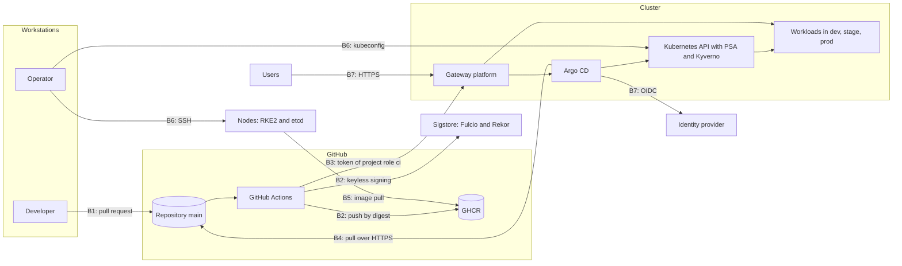

# Threat model

This page names what the platform protects, where trust changes hands, which threats it addresses and what risk remains. It ends with commands that demonstrate the admission and network controls on a running cluster. It is for reviewers who assess the platform and operators who adapt it to their own environment. The controls themselves are described once, in [security controls](controls.md).

## Scope

In scope: one cluster per profile (`lab` on kind, `reference` on RKE2), the namespaces `dev`, `stage` and `prod`, the platform components Argo CD deploys, the GitHub repository and its workflows, the container registry, and the nodes Ansible provisions.

Out of scope: the security of the identity provider, of GitHub and GHCR as services, of the hypervisor or cloud that hosts the nodes, and of the application code inside `hello-api`. The optional Jenkins adapter is covered only by its entry in [known limitations](known-limitations.md#the-jenkins-adapter-has-a-larger-attack-surface). The hub mode of the bootstrap chart, in which one Argo CD manages several clusters, is not modelled here.

## Assets

| Asset | Why it matters |
| --- | --- |
| `main` branch of the repository | It is the desired state of the cluster. Argo CD applies it with cluster-wide rights. |
| Container images and their signatures in GHCR | What runs in `stage` and `prod` must be the digest that was scanned, signed and promoted. |
| Argo CD | Its application controller can write any object in the cluster. |
| Kubernetes API and etcd | etcd holds every Secret; the API is the only way to change the cluster. |
| Secret material | Sealed Secrets controller key, OpenBao data and its unseal or recovery keys, age keys for SOPS, the Ansible vault password, the RKE2 join token, the admin kubeconfig. |
| Nodes | Root on a node is equivalent to control of every pod on it, and on a server node, of etcd. |
| Workloads and their data in `prod` | The business purpose of the platform. |
| CI credentials | `GITHUB_TOKEN`, the GitHub OIDC tokens used for signing, the optional GitHub App key for workflow pull requests, the Argo CD tokens of the read-only AppProject role `ci`. When enabled, the in-cluster GitHub credentials of Kargo (`kargo-git`: push and pull requests) and of the preview ApplicationSet (`github-previews`: reads pull requests). |

## Trust boundaries



| Boundary | Crossing | What protects it |
| --- | --- | --- |
| B1 | Developer workstation to GitHub | GitHub authentication, pull-request review, `ci-gate`, CODEOWNERS for `envs/prod/`, the branch ruleset; gitleaks as a `pre-commit` hook and in CI |
| B2 | GitHub Actions to GHCR and Sigstore | Least-privilege job permissions, SHA-pinned actions, short-lived OIDC identity for signing; no long-lived signing key |
| B3 | GitHub Actions to the Argo CD API | Optional. Tokens of the AppProject role `ci` in `apps-dev` and `apps-stage`, with an expiry, which may only get the Applications of their project; `promote.yml` uses them to check sync and health status, never to sync. With the workflows engine promotion itself is a pull request; with Kargo, `dev` and `stage` promotions are commits by the Kargo Git credential and `prod` is a pull request |
| B4 | Repository to Argo CD | In `reference`, Argo CD pulls from GitHub over HTTPS with certificate verification. In `lab`, it pulls from an in-cluster Gitea seeded from the local `HEAD`. In both, the cluster accepts no push from CI |
| B5 | Registry to nodes | Deployment by digest; registry allowlist; signature verification and the vulnerability attestation gate in `stage` and `prod` in the `reference` profile |
| B6 | Operator workstation to nodes and to the API | Key-only SSH with pinned host keys; firewall source CIDRs; kubeconfig with mode 0600, gitignored |
| B7 | Users to the Gateway, Argo CD to the identity provider | TLS on the `https` listener; Argo CD SSO with group-based RBAC in `reference` |

## Threats and mitigations

The table follows STRIDE. Mitigations are facts about the platform and link to [security controls](controls.md). The residual risk column is an assessment.

| ID | Category | Threat | Mitigations | Residual risk |
| --- | --- | --- | --- | --- |
| T1 | Spoofing | Someone signs in to Argo CD with a stolen or default credential. | SSO with roles mapped from `platform.groups`, an empty `policy.default` and the local admin disabled in `reference`; automation uses tokens of the read-only AppProject role `ci`, with an expiry and no login. See [Argo CD sign-in and authorization](controls.md#enforcement-matrix) and [Argo CD SSO](argocd-sso.md). | Medium. A compromised identity-provider account gets the rights of its groups; MFA is the identity provider's control. The `lab` profile uses the initial admin secret. |
| T2 | Spoofing | An image that was not built by this repository runs under a trusted name. | Registry allowlist and tag rule; deployment by digest; signature verification in `stage` and `prod` in `reference`. See [image signature verification](controls.md#enforcement-matrix) and [supply chain](supply-chain.md#admission). | Medium in `dev` and in `lab`, where signatures are not verified. Low in `stage` and `prod` in `reference`. |
| T3 | Spoofing | A man in the middle impersonates a node, the Git server or the API. | Pinned `known_hosts` and `host_key_checking = True`; in `reference`, Argo CD pulls from GitHub over HTTPS with certificate verification. See [SSH and host identity](controls.md#enforcement-matrix). | Low. Host keys must be collected over a trusted path the first time. |
| T4 | Tampering | A malicious or mistaken change on `main` reaches the cluster. | Pull requests with `ci-gate`; CODEOWNERS for `envs/prod/`; AppProjects; prod sync window in `reference`; `policy-test`, `trivy-config` and kubeconform before merge. See [change control](controls.md#enforcement-matrix) and [AppProjects](controls.md#appprojects-limit-applications-not-the-argo-cd-controller). | High for platform paths: merge rights there are equivalent to cluster-admin. The branch ruleset is a repository setting outside Git and must be configured by the owner. |
| T5 | Tampering | A compromised GitHub Action or tool steals CI credentials or alters a build. | Actions pinned by full SHA; workflow-level `permissions: contents: read` in `validate.yml` and `permissions: {}` in the other workflows, with per-job grants; zizmor; Renovate pull requests with review; dependency review; OpenSSF Scorecard. See [workflow hardening](controls.md#enforcement-matrix) and [dependency hygiene](supply-chain.md#dependency-hygiene). | Medium. A malicious update that a reviewer approves still lands. |
| T6 | Tampering | An image is replaced in the registry after it was tested. | Deployment by digest; cosign signature and GitHub attestation bound to the digest; admission verification. See [supply chain](supply-chain.md). | Low where verification is on; a digest cannot be re-pointed. |
| T7 | Tampering | A workload breaks out of its container to the node. | PSA `restricted`; Kyverno workload contract; helm-common defaults. See [defence in depth](controls.md#defence-in-depth-pod-security-admission-and-kyverno). | Medium. A kernel or container runtime vulnerability is not covered; runtime detection is off by default. |
| T8 | Repudiation | A change to the cluster cannot be attributed. | Every change is a commit; with the workflows engine every change, promotion included, is a reviewed pull request, and with Kargo the `dev` and `stage` promotions are commits by the Kargo credential, recorded as Promotions in Kargo; self-heal reverts manual drift. | Medium. The `rke2` role enables API server audit logging by default, so direct API use, including break-glass access, is recorded on RKE2 servers. The log stays on the nodes, where root on a server can alter it, and kind clusters have none. |
| T9 | Information disclosure | A secret is committed to Git. | gitleaks in `pre-commit` and in CI (weekly full-history scan, custom rules for addresses and domains); the CI check against `kind: Secret` with data; Sealed Secrets or ESO only; `.gitignore` entries. See [secrets handling](secrets-handling.md). | Low for new commits. |
| T10 | Information disclosure | A Secret is read from the cluster. | Secrets encrypted in etcd by RKE2; viewers get the built-in `view` ClusterRole, which excludes Secrets; the `deployer` Role grants no Secrets and only operational writes (patch on workloads for restart, rollout promote and abort, pod delete, Job create, exec and port-forward only in `dev` by default); ServiceAccount token automount off; default-deny NetworkPolicies. See [Kubernetes RBAC](controls.md#enforcement-matrix). | Medium. Argo CD, cluster administrators and holders of the admin kubeconfig can read every Secret; admins hold the `admin` ClusterRole in each environment namespace. A deployer who patches a workload or creates a Job can run a pod that mounts a namespace Secret. kind does not encrypt Secrets at rest. |
| T11 | Information disclosure | Argo CD's cache is read or poisoned through Redis. | Redis authentication; Argo CD NetworkPolicies and the `argocd` namespace baseline. | Low. |
| T12 | Denial of service | A workload exhausts cluster resources. | ResourceQuota and LimitRange per namespace; the requests and limits rule. See [resource bounds](controls.md#enforcement-matrix). | Medium. All environments share one cluster, so node-level pressure from `dev` can affect `prod`. |
| T13 | Denial of service | The admission webhook is unavailable. | PSA keeps enforcing, because it is built into the API server. | Medium. Whether Kyverno fails open or closed depends on each policy's failure policy. |
| T14 | Elevation of privilege | An app change creates cluster-scoped objects, RBAC or quota changes in its namespace. | App projects allow one namespace, no cluster-scoped kinds and no ResourceQuota, LimitRange, Role or RoleBinding. See [Argo CD tenancy](controls.md#enforcement-matrix). | Low. The per-app NetworkPolicy comes from the app chart, so an app change can widen ingress to its own pods; review of the chart and of `envs/` is the control, and an Audit-mode Kyverno policy reports a policy that admits all namespaces to all pods. |
| T15 | Elevation of privilege | Argo CD itself is compromised. | Supported release kept current by Renovate; SSO and RBAC; Redis authentication; NetworkPolicies; locked `default` project. | High impact, low likelihood. A compromised Argo CD controls the whole cluster. |
| T16 | Elevation of privilege | A node is reached through an exposed port. | Host firewall with source CIDRs; key-only SSH; optional CIS profile. See [host firewall](controls.md#enforcement-matrix). | Medium. The CIS profile is opt-in. |

## Policy demonstrations

These commands show the admission and network controls on a running cluster: the `lab` profile from `make demo`, or a `reference` cluster. They assume that `hello-api` is deployed in `stage`, `dev` and `prod`, and they reuse its image so that only the rule under test fails. The `e2e-kind` job runs equivalent assertions on every pull request (privileged, root and `latest` pods are denied, traffic between environments is blocked), and `make policy-test` evaluates comparable fixtures without a cluster.

Read the image reference of the running Deployment first:

```bash
IMAGE=$(kubectl -n stage get deployment hello-api \
  -o jsonpath='{.spec.template.spec.containers[0].image}')
REPO=${IMAGE%@*}
REPO=${REPO%:*}
echo "image: ${IMAGE}"
echo "repository: ${REPO}"
```

### Telling PSA and Kyverno apart

In `stage` and `prod`, Pod Security Admission (`restricted`) rejects a privileged pod before Kyverno sees it, so the rejection message comes from PSA. The two sources are easy to distinguish:

- A PSA rejection is a `Forbidden` error whose message contains `is forbidden: violates PodSecurity "restricted:<version>"`, where `<version>` is the pinned `enforce-version` of the namespace. A list of every failed check follows, such as `privileged` or `runAsNonRoot != true`.
- A Kyverno rejection comes from Kyverno's admission webhook. It names the policy that failed and carries the message defined in that policy. It never contains `violates PodSecurity`.

### Privileged pod in stage

```bash
kubectl apply -f - <<EOF
apiVersion: v1
kind: Pod
metadata:
  name: privileged-test
  namespace: stage
spec:
  restartPolicy: Never
  containers:
    - name: app
      image: ${IMAGE}
      securityContext:
        privileged: true
EOF
```

Expected: denied by PSA. The message contains `violates PodSecurity "restricted:<version>"` and lists `privileged` among the failed checks. No Kyverno message appears, because the request ends at PSA.

### Pod without probes or limits in stage

This pod meets the `restricted` level, so it passes PSA and reaches Kyverno.

```bash
kubectl apply -f - <<EOF
apiVersion: v1
kind: Pod
metadata:
  name: no-probes-test
  namespace: stage
spec:
  restartPolicy: Never
  securityContext:
    runAsNonRoot: true
    runAsUser: 65532
    seccompProfile:
      type: RuntimeDefault
  containers:
    - name: app
      image: ${IMAGE}
      securityContext:
        runAsNonRoot: true
        allowPrivilegeEscalation: false
        readOnlyRootFilesystem: true
        capabilities:
          drop: ["ALL"]
EOF
```

Expected: denied by Kyverno (Enforce). The message names the probe policy. If the namespace LimitRange sets default requests and limits, the API server fills them in before validation and the message names only the probe policy; otherwise it also names the resource policy.

### Pod with a latest tag in stage

This pod is complete except for its image tag.

```bash
kubectl apply -f - <<EOF
apiVersion: v1
kind: Pod
metadata:
  name: latest-tag-test
  namespace: stage
spec:
  restartPolicy: Never
  securityContext:
    runAsNonRoot: true
    runAsUser: 65532
    seccompProfile:
      type: RuntimeDefault
  containers:
    - name: app
      image: ${REPO}:latest
      ports:
        - containerPort: 8080
      readinessProbe:
        httpGet:
          path: /readyz
          port: 8080
      livenessProbe:
        httpGet:
          path: /healthz
          port: 8080
      resources:
        requests:
          cpu: 50m
          memory: 32Mi
        limits:
          cpu: 200m
          memory: 64Mi
      securityContext:
        runAsNonRoot: true
        allowPrivilegeEscalation: false
        readOnlyRootFilesystem: true
        capabilities:
          drop: ["ALL"]
EOF
```

Expected: denied by Kyverno. The message names the image tag policy. In the `reference` profile the image verification policy can report the same pod as well; each message names its own policy.

### Audit mode in dev

Apply the privileged pod from above with `namespace: dev`. It is rejected by PSA in `dev` as well: the namespace carries an enforce label, and both the `baseline` and `restricted` levels forbid privileged containers. Audit mode in `dev` applies to the Kyverno rules that go beyond the Pod Security Standards, so it shows only for pods that pass PSA.

Apply the `latest` tag pod from above with `namespace: dev` instead. Kyverno admits it, because `dev` runs in Audit, and records the result in a PolicyReport. The pod may fail to pull its image; the report is what matters.

```bash
kubectl -n dev get pod latest-tag-test
kubectl -n dev get policyreports
kubectl -n dev get policyreports -o yaml \
  | yq '.items[] | select(.scope.name == "latest-tag-test") | .results[] | select(.result == "fail") | [.policy, .message]'
```

Expected: the pod exists, and the report for it lists a `fail` result for the image tag policy. Kyverno writes reports asynchronously; if the list is empty, repeat the command after a few seconds. Remove the demonstration pod afterwards:

```bash
kubectl -n dev delete pod latest-tag-test
```

### Cross-namespace traffic

A temporary pod in `dev` tries to reach the `hello-api` Service in `prod`. The `dev` namespace denies all egress except DNS and the egress rules each app declares for its own pods, and in `prod` the `hello-api` NetworkPolicy admits traffic only from `envoy-gateway-system` on the service port and from the monitoring namespace on the metrics port, so the connection times out. The pod runs in `dev` because Kyverno there only audits its image registry; it meets the `restricted` level, so PSA admits it.

```bash
PORT=$(kubectl -n prod get service hello-api -o jsonpath='{.spec.ports[0].port}')
kubectl apply -f - <<EOF
apiVersion: v1
kind: Pod
metadata:
  name: netcheck
  namespace: dev
spec:
  restartPolicy: Never
  securityContext:
    runAsNonRoot: true
    runAsUser: 100
    seccompProfile:
      type: RuntimeDefault
  containers:
    - name: curl
      image: curlimages/curl:8.11.1
      command: ["curl"]
      args: ["-sS", "--max-time", "5", "http://hello-api.prod.svc:${PORT}/healthz"]
      securityContext:
        allowPrivilegeEscalation: false
        readOnlyRootFilesystem: true
        capabilities:
          drop: ["ALL"]
EOF
kubectl -n dev wait pod/netcheck --for=jsonpath='{.status.phase}'=Failed --timeout=60s
kubectl -n dev logs netcheck
kubectl -n dev delete pod netcheck
```

Expected: the pod ends in phase `Failed`, and its log shows curl exit code 28, a timeout. The name resolves, because DNS egress is allowed; the connection itself is dropped.
